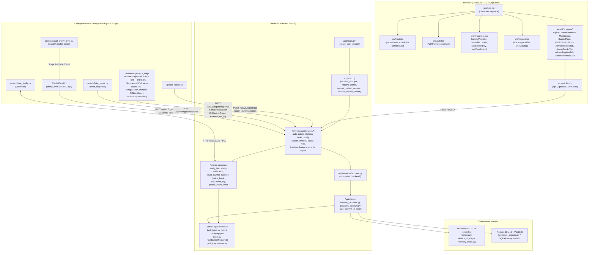
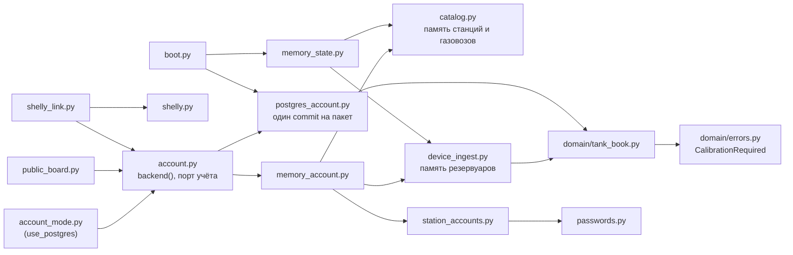
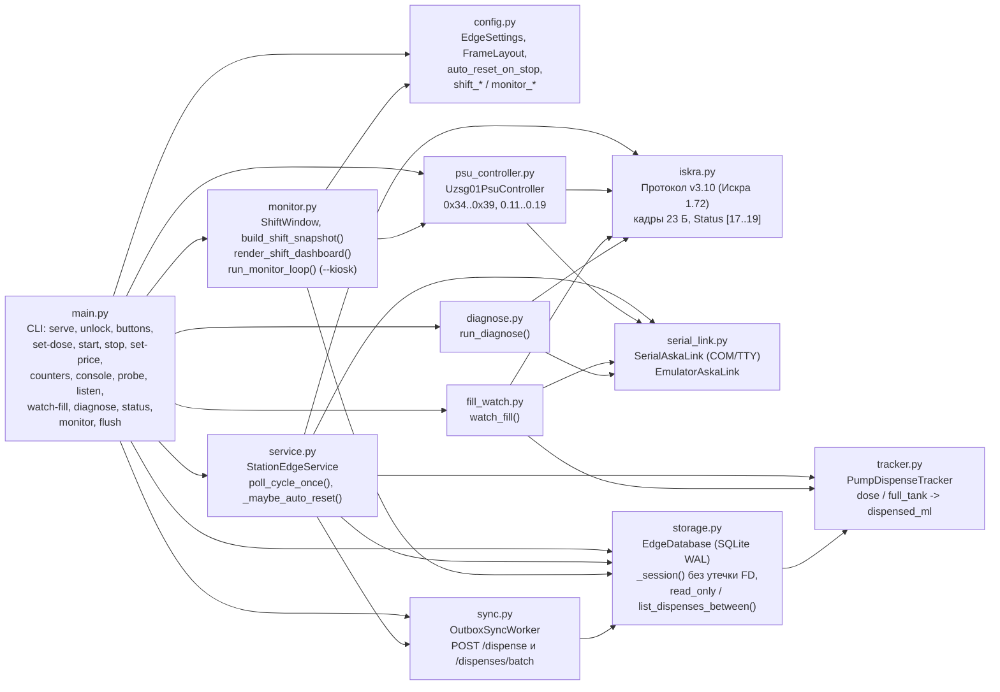

# Полный аудит кода и графовое древо проекта «Цифровой след LPG»

> [!NOTE]
> Результаты автоматических проверок проекта (`d:\Проект\day`):
> - **Station Edge (`pytest -c station-edge/pyproject.toml --cov=agzs_edge station-edge/tests`)**: `64 passed in 5.49s` (покрытие `agzs_edge`: **92%**, все 8 тестовых модулей: Протокол v3.10 / Искра 1.72, контроллер БП без ПУ `Uzsg01PsuController`, авто-сброс `0x37`, трекер `dispensed_ml`, SQLite WAL + `read_only=True`, чанкированный Bulk Outbox Sync `MAX_BATCH_SIZE = 200`, `SerialAskaLink`, `fill_watch`, монитор смены `monitor.py`, кроссплатформенный `diagnose` и CLI).
> - **Backend (`pytest backend/tests`)**: `78` тестов в коллекции (`26 passed` в офлайн unit-прогоне без `TestClient`: баланс, калибровка, книга резервуара, приём/выдача `DispenseReadingOut`, политика, журнал уровней, снимки памяти и скрипт Shelly).
> - **Линтер и компиляция (`ruff check station-edge backend` + `python -m compileall backend station-edge -q`)**: `All checks passed!`, `0 ошибок` синтаксиса/компиляции.
> - **Frontend (`tsc --noEmit && vite build`)**: `PASSED` (72 модуля собрано, модульная архитектура CSS и компонентов).

---

## 1. Архитектурный граф взаимодействия модулей (Mermaid)

### 1.1. Общая схема потоков данных и подсистем



### 1.2. Граф зависимостей сервисного слоя Backend (`backend/app/services/*`)



### 1.3. Граф модулей станционного узла (`station-edge/agzs_edge/*`)



---

## 2. Полное графовое древо проекта (папки, файлы, классы, функции)

Ниже представлено полное иерархическое дерево всего репозитория `d:\Проект\day` со всеми директориями, файлами, классами, типами и функциями.

```text
d:\Проект\day\
├── .dockerignore
├── .gitignore
├── README.md
├── docker-compose.yml
├── project_graph_and_audit.md
├── выступление.md
├── Паспорт_проекта.md
│
├── deploy/
│   ├── .env.example
│   ├── Dockerfile.web
│   ├── docker-compose.yml
│   └── nginx.conf
│
├── hardware/
│   └── shelly-plus-uni-case/
│       ├── build_case.py
│       ├── case_base.stl
│       ├── case_lid.stl
│       ├── din_bracket.stl
│       ├── shelly_plus_uni_case.blend
│       ├── shelly_plus_uni_case.stl
│       └── shelly_seat_test.stl
│
├── backend/
│   ├── Dockerfile
│   ├── pytest.ini
│   ├── requirements.txt
│   ├── alembic.ini
│   ├── alembic/
│   │   ├── env.py                        ├── get_url()
│   │   │                                 ├── run_migrations_offline()
│   │   │                                 └── run_migrations_online()
│   │   └── versions/
│   │       ├── 0001_initial_sketch.py    ├── upgrade() / downgrade()
│   │       ├── 0002_account_store.py     ├── upgrade() / downgrade()
│   │       └── 0003_high_scale_ingest_and_cleanup.py ├── upgrade() / downgrade()
│   ├── scripts/
│   │   ├── fake_shelly.py                ├── _State (dataclass)
│   │   │                                 ├── _Handler (BaseHTTPRequestHandler)
│   │   │                                 │   ├── do_GET()
│   │   │                                 │   ├── do_POST()
│   │   │                                 │   ├── log_message()
│   │   │                                 │   ├── _rpc()
│   │   │                                 │   ├── _send()
│   │   │                                 │   └── _error()
│   │   │                                 └── main()
│   │   ├── fake_topaz.py                 ├── send_dispense()
│   │   │                                 └── main()
│   │   ├── install_shelly_level.py       ├── rpc()
│   │   │                                 ├── render_script()
│   │   │                                 ├── _js_string()
│   │   │                                 ├── find_or_create_script()
│   │   │                                 ├── put_code()
│   │   │                                 ├── install()
│   │   │                                 └── main()
│   │   └── shelly_level.js               ├── isoNow()
│   │                                     ├── roundVolts()
│   │                                     └── sendVolts()
│   ├── app/
│   │   ├── __init__.py
│   │   ├── config.py                     ├── Settings (BaseSettings)
│   │   │                                 │   ├── cors_origin_list (property)
│   │   │                                 │   ├── ingest_level_path (property)
│   │   │                                 │   └── ingest_level_url (property)
│   │   │                                 └── get_settings()
│   │   ├── database.py                   ├── Base (DeclarativeBase)
│   │   │                                 └── get_db()
│   │   ├── auth.py                       ├── Principal (dataclass) [.is_admin, .stations()]
│   │   │                                 ├── reset_auth_state()
│   │   │                                 ├── check_login_rate_limit()
│   │   │                                 ├── record_login_failure()
│   │   │                                 ├── clear_login_failures()
│   │   │                                 ├── revoke_token()
│   │   │                                 ├── _same()
│   │   │                                 ├── issue_token()
│   │   │                                 ├── _decode_verified_payload()
│   │   │                                 ├── _parse_token_fields()
│   │   │                                 ├── read_principal()
│   │   │                                 ├── read_token()
│   │   │                                 ├── credentials_match()
│   │   │                                 ├── is_admin_authorization()
│   │   │                                 ├── current_principal()
│   │   │                                 ├── require_admin()
│   │   │                                 ├── require_principal()
│   │   │                                 ├── require_station_access()
│   │   │                                 └── require_station_owner()
│   │   ├── main.py                       ├── _lifespan()
│   │   │                                 └── create_app()
│   │   ├── domain/
│   │   │   ├── __init__.py
│   │   │   ├── access.py                 └── ROLE_ADMIN, ROLE_STATION, is_admin_role(), may_read_station()
│   │   │   ├── errors.py                 └── CalibrationRequired
│   │   │   ├── level_policy.json
│   │   │   ├── policy.py                 └── _load_policy()
│   │   │   └── tank_book.py              ├── recompute_tank_book(), build_ingest_ack(),
│   │   │                                 │   build_tank_ingest_state(), apply_level_reading(),
│   │   │                                 │   apply_dispense_volume(), apply_receipt_volume(),
│   │   │                                 └── summarize_station_tanks()
│   │   ├── models/
│   │   │   ├── __init__.py
│   │   │   ├── station.py                ├── Station (Base) [ix_stations_is_active]
│   │   │   │                             ├── Tank (Base) [uq_tanks_station_code, ix_tanks_station_id]
│   │   │   │                             ├── LevelReading (Base) [ix_level_readings_tank_recorded]
│   │   │   │                             └── StationUser (Base) [ix_station_users_username]
│   │   │   ├── dispenser.py              ├── DispenseRecord (Base) [uq external_txn_id, ix_dispense_records_tank_started]
│   │   │   │                             └── ReceiptRecord (Base) [uq source_event_id, ix_receipt_records_tank_recorded]
│   │   │   ├── truck.py                  ├── TripStatus (Enum)
│   │   │   │                             ├── Truck (Base) [ix_trucks_status, lat, lon]
│   │   │   │                             └── TruckTrip (Base)
│   │   │   ├── batch.py                  ├── BatchStatus (Enum)
│   │   │   │                             ├── Batch (Base)
│   │   │   │                             └── BatchTrailEvent (Base)
│   │   │   ├── balance.py                └── BalanceSnapshot (Base)
│   │   │   └── event.py                  ├── DiscrepancyType (Enum)
│   │   │                                 ├── DiscrepancySeverity (Enum)
│   │   │                                 └── DiscrepancyEvent (Base)
│   │   ├── schemas/
│   │   │   ├── __init__.py
│   │   │   ├── common.py                 ├── GeoPoint, TimeRange
│   │   │   ├── auth.py                   ├── LoginIn, TokenOut, UserOut
│   │   │   ├── public.py                 ├── PublicTankLevelOut, PublicStationLevelsOut
│   │   │   ├── station.py                ├── TankOut, StationOut, StationCreateIn, StationUpdateIn,
│   │   │   │                             │   TankDeviceCreateIn, TankDeviceUpdateIn, ShellyLinkIn,
│   │   │   │                             │   ShellyDeviceOut, TankDeviceOut, TankLevelRowOut,
│   │   │   │                             │   DispenseReadingOut, StationUserCreateIn, StationUserOut
│   │   │   ├── truck.py                  ├── TruckOut, TruckCreateIn, TruckUpdateIn, MapPoint, MapOverview
│   │   │   ├── batch.py                  ├── TrailStep, BatchTrailOut
│   │   │   ├── balance.py                ├── BalanceReconcileIn, BalanceSnapshotOut
│   │   │   ├── event.py                  └── DiscrepancyEventOut
│   │   │   └── ingest.py                 └── DispenseIngest, ReceiptIngest, CalibrationIn,
│   │   │                                     LevelIngest, IngestAck, TankRuntimeOut
│   │   ├── routers/
│   │   │   ├── __init__.py
│   │   │   ├── auth.py                   ├── issue_access_token(), read_me()
│   │   │   ├── public.py                 └── public_stations()
│   │   │   ├── stations.py               ├── list_station_cards(), create_station_card(),
│   │   │   │                             │   patch_station_card(), remove_station_card(),
│   │   │   │                             │   get_station_card(), station_to_out()
│   │   │   ├── tanks.py                  ├── list_tanks(), list_station_devices(),
│   │   │   │                             │   create_station_device(), patch_station_device(),
│   │   │   │                             │   remove_station_device(), list_device_levels(),
│   │   │   │                             │   list_station_dispenses(), device_to_out()
│   │   │   ├── shelly.py                 ├── put_station_shelly(), delete_station_shelly()
│   │   │   ├── station_owners.py         ├── list_station_logins(), create_station_login()
│   │   │   ├── trucks.py                 ├── get_trucks(), post_truck(), patch_truck(), get_truck()
│   │   │   ├── map.py                    └── map_overview()
│   │   │   ├── batches.py                └── get_batch_trail()
│   │   │   ├── balance.py                ├── reconcile_balance(), list_snapshots()
│   │   │   ├── events.py                 ├── list_events(), acknowledge_event()
│   │   │   └── ingest.py                 ├── require_device(), calibrate(), ingest_gps(),
│   │   │                                     ingest_level(), ingest_levels_batch(),
│   │   │                                     ingest_dispense(), ingest_dispenses_batch(),
│   │   │                                     ingest_receipt(), ingest_tank()
│   │   └── services/
│   │       ├── __init__.py
│   │       ├── account_mode.py           └── use_postgres()
│   │       ├── account.py                ├── backend(), _levels(), list_stations(),
│   │       │                             │   get_station(), create_station(), update_station(),
│   │       │                             │   delete_station(), list_trucks(), get_truck(),
│   │       │                             │   create_truck(), update_truck(), delete_truck(),
│   │       │                             │   record_truck_position(), list_active_stations_with_tanks(),
│   │       │                             │   list_tank_devices(), accept_level(), accept_levels_batch(),
│   │       │                             │   accept_dispense(), accept_dispenses_batch(),
│   │       │                             │   accept_receipt(), bind_level(), bind_dispense(),
│   │       │                             │   list_station_users(), authenticate_station_user(),
│   │       │                             └── list_level_readings(), list_dispense_records()
│   │       ├── memory_account.py         └── фасад памяти: те же имена, что у postgres_account
│   │       ├── boot.py                   ├── boot_store(), persist_state()
│   │       ├── calibration.py            ├── LevelCalibration (dataclass), round_volts(),
│   │       │                             │   level_volts_changed(), round_percent(),
│   │       │                             │   remainder_fill_percent(), same_published_level(),
│   │       │                             │   volts_to_percent(), volts_to_liters()
│   │       ├── level_journal.py          ├── PublishedLevel (Protocol), published_levels()
│   │       ├── balance.py                ├── ReconciliationResult (dataclass), calculate_remainder(),
│   │       │                             │   classify_discrepancy()
│   │       ├── balance_log.py            ├── record_snapshot(), list_recorded_snapshots(),
│   │       │                             │   reset_balance_log()
│   │       ├── event_log.py              ├── record_event(), list_recorded_events(),
│   │       │                             │   acknowledge_recorded_event(), open_events_count(),
│   │       │                             │   reset_events()
│   │       ├── batch_book.py             ├── BatchRecord (dataclass), register_receipt_batch(),
│   │       │                             │   find_batch_by_code(), reset_batches()
│   │       ├── trail.py                  └── build_batch_trail()
│   │       ├── passwords.py              ├── hash_password(), verify_password()
│   │       ├── station_accounts.py       ├── StationOwner (dataclass), create_owner(),
│   │       │                             │   grant_owner(), list_owners(),
│   │       │                             │   authenticate_owner(), snapshot(),
│   │       │                             │   restore_snapshot(), reset_station_accounts()
│   │       ├── catalog.py                ├── StationCard (dataclass), TruckCard (dataclass),
│   │       │                             │   reset_catalog(), list_stations(), get_station(),
│   │       │                             │   create_station(), update_station(), delete_station(),
│   │       │                             │   list_trucks(), get_truck(), create_truck(),
│   │       │                             │   update_truck(), delete_truck(),
│   │       │                             │   record_truck_position(), snapshot(), restore_snapshot()
│   │       ├── device_ingest.py          ├── TankDevice (dataclass), TankBook (dataclass),
│   │       │                             │   reset_device_ingest(), register_tank(),
│   │       │                             │   update_tank_device(), list_tank_devices(),
│   │       │                             │   get_tank_device(), tank_by_token(), tank_remainder(),
│   │       │                             │   has_calibration(), set_calibration(), accept_level(),
│   │       │                             │   accept_levels_batch(), accept_receipt(),
│   │       │                             │   accept_dispense(), accept_dispenses_batch(),
│   │       │                             │   parse_dispense_meta(), list_dispense_records(),
│   │       │                             │   bind_level(), bind_dispense(), tank_state(),
│   │       │                             │   snapshot(), restore_snapshot()
│   │       ├── shelly.py                 ├── ShellyError (Exception), ShellySnapshot (dataclass),
│   │       │                             │   ShellyRpc (Protocol), HttpShellyRpc, parse_rpc_payload(),
│   │       │                             │   snapshot_from(), read_snapshot()
│   │       ├── shelly_link.py            ├── ShellyLink (dataclass), set_shelly_rpc(),
│   │       │                             │   reset_shelly_links(), normalize_host(),
│   │       │                             │   connect_shelly(), disconnect_shelly(), shelly_view(),
│   │       │                             │   poll_one(), snapshot_bindings(), restore_bindings()
│   │       ├── public_board.py           ├── list_public_levels(), _is_online(), _utc()
│   │       ├── memory_state.py           ├── persist(), restore()
│   │       └── postgres_account.py       ├── session(), _insert_once(), _accept_level(),
│   │                                         _accept_dispense(), accept_levels_batch(),
│   │                                         accept_dispenses_batch() — один commit,
│   │                                         record_truck_position(), list_stations(),
│   │                                         register_tank(), accept_level(), accept_dispense(),
│   │                                         accept_receipt(), list_level_readings(),
│   │                                         list_dispense_records(),
│   │                                         create_station_user(), authenticate_station_user(),
│   │                                         import_memory_snapshot()
│   └── tests/
│       ├── conftest.py                   └── _auth_open_for_tests()
│       ├── test_account_port.py         └── 8 тестов (выбор адаптера, CalibrationRequired → 422,
│       │                                     GPS координата и дубль, откат пакета PostgreSQL)
│       ├── test_api.py                   └── 6 тестов (health, map, batch 404, reconcile, dispense, levels)
│       ├── test_auth.py                  └── 5 тестов (login, expired/revoked token, rate limit, SSRF)
│       ├── test_balance.py               └── 5 тестов (calculate_remainder, ok, shortage, surplus, band)
│       ├── test_bulk_ingest.py           └── 3 теста (пакетный инжест наливов, уровней, TTL-кэш витрины)
│       ├── test_calibration.py           └── 7 тестов (midpoint, endpoints, dial clamp, rounding, flat)
│       ├── test_catalog.py               └── 4 теста (seed stations, CRUD station, tank, CRUD truck)
│       ├── test_device_ingest.py         └── 8 тестов (dispense/shortage, calibration, receipt, noise, token)
│       ├── test_level_journal.py         └── 1 тест (published_levels noise threshold)
│       ├── test_memory_state.py          └── 1 тест (persist & restore across reset)
│       ├── test_policy.py                └── 4 теста (level_policy.json sync, api_prefix, rounding)
│       ├── test_public_levels.py         └── 2 теста (fill_only, empty tank)
│       ├── test_sensor_online.py         └── 2 теста (fresh online, stale offline)
│       ├── test_shelly.py                └── 9 тестов (snapshot, RPC, auto-voltmeter, link, cal, offline)
│       ├── test_shelly_script.py         └── 3 теста (render_script placeholders, escaping, validation)
│       ├── test_station_access.py        └── 5 тестов (RBAC station/owner/admin, multi-station)
│       └── test_tank_book.py             └── 5 тестов (книга резервуара, шум вольт, сводка станции, DispenseReadingOut)
│
├── station-edge/
│   ├── README.md
│   ├── .env.example
│   ├── pyproject.toml
│   ├── requirements.txt
│   ├── run_station_edge.bat
│   ├── station-edge.service
│   ├── station-edge-monitor.service
│   ├── agzs_edge/
│   │   ├── __init__.py
│   │   ├── __main__.py
│   │   ├── config.py                     ├── FrameLayout (dataclass)
│   │   │                                 ├── EdgeSettings (dataclass) [.__post_init__(), .from_env(),
│   │   │                                 │   .dispenser_uuid(), auto_reset_on_stop, auto_reset_delay_sec,
│   │   │                                 │   shift_start_hour, shift_hours, monitor_refresh_sec,
│   │   │                                 │   monitor_kiosk, currency_symbol]
│   │   │                                 ├── load_dotenv()
│   │   │                                 ├── _resolve_preferred_port()
│   │   │                                 ├── _parse_bool()
│   │   │                                 ├── _parse_addresses()
│   │   │                                 └── _parse_dispenser_map()
│   │   ├── iskra.py                      ├── CMD_*_ASCII (0x33..0x39), PARAM_PRICE_CODES (0.1..0.19)
│   │   │                                 ├── IskraFrameError (ValueError)
│   │   │                                 ├── IskraTelemetryFrame (dataclass) [.raw_hex, .volume_raw,
│   │   │                                 │   .reported_volume_ml, .preset_dose_ml, .is_dispensing,
│   │   │                                 │   .is_finished_state, .has_protocol_alarm, .status_byte17,
│   │   │                                 │   .status_byte18, .sost_byte19, .valve_open,
│   │   │                                 │   .start_stop_buttons_enabled, .reset_button_enabled,
│   │   │                                 │   .dose_type_bits, .column_error_code, .is_locked_in_stop]
│   │   │                                 ├── compute_bcc(), verify_frame_checksum()
│   │   │                                 ├── _format_six_field(), build_command_frame()
│   │   │                                 ├── build_test_command(), build_reset_command()
│   │   │                                 ├── build_set_dose_command(), build_start_command()
│   │   │                                 ├── build_stop_command(), build_param_command()
│   │   │                                 ├── build_test_response_frame(), _read_error_field()
│   │   │                                 ├── _decode_price(), _completed_volume_in_price_field()
│   │   │                                 └── _validate_frame_envelope(), _decode_sost_field(), parse_iskra_frame()
│   │   ├── psu_controller.py             ├── COLUMN_ERROR_DESCRIPTIONS, STATE_DESCRIPTIONS_RU
│   │   │                                 ├── PsuControlError (RuntimeError)
│   │   │                                 ├── ResetResult (dataclass)
│   │   │                                 ├── CountersReport (dataclass) [.render()]
│   │   │                                 ├── _decode_dose_type_ru(), format_detailed_status()
│   │   │                                 └── Uzsg01PsuController [.get_status(), .reset_column(),
│   │   │                                     .set_buttons_mode(), .preset_dose(), .start_pump(),
│   │   │                                     .stop_pump(), .set_price(), .read_counters()]
│   │   ├── tracker.py                    ├── CompletedDispense (dataclass)
│   │   │                                 ├── _frame_error_code()
│   │   │                                 ├── _ActiveSession (dataclass)
│   │   │                                 └── PumpDispenseTracker [.active_session(), .process_frame()]
│   │   ├── serial_link.py                ├── PollRawResult (dataclass)
│   │   │                                 ├── AskaLink (Protocol)
│   │   │                                 ├── SerialAskaLink [.open(), .close(), .poll_test(), .send_command()]
│   │   │                                 ├── EmulatorAskaLink [.open(), .close(), .poll_test(), .send_command()]
│   │   │                                 └── list_available_serial_ports()
│   │   ├── storage.py                    ├── OutboxItem (dataclass), DispenseRow (dataclass) [.amount_kzt]
│   │   │                                 ├── _to_utc(), parse_iso_datetime(), _parse_iso_utc(), _row_to_dispense()
│   │   │                                 └── EdgeDatabase [._connect(), ._session(), ._init_schema(),
│   │   │                                     ._empty_summary(), .update_live_state(), .mark_no_response(),
│   │   │                                     .log_raw_frame(), .record_completed_dispense(),
│   │   │                                     .fetch_due_outbox(), .mark_outbox_sent(),
│   │   │                                     .mark_outbox_batch_sent(), .mark_outbox_failed(),
│   │   │                                     .list_dispenses(), .list_dispenses_between(), .summary()]
│   │   ├── monitor.py                    ├── ShiftWindow (dataclass), PumpShiftSummary (dataclass)
│   │   │                                 ├── ShiftDispenseEntry (dataclass), ShiftDashboardSnapshot (dataclass)
│   │   │                                 ├── resolve_shift_window(), _format_local_time(),
│   │   │                                 │   _state_label(), _mode_label(),
│   │   │                                 │   _format_money(), _format_price()
│   │   │                                 ├── build_shift_snapshot(), render_shift_dashboard()
│   │   │                                 └── install_kiosk_signal_handlers(), run_monitor_loop()
│   │   ├── sync.py                       ├── MAX_BATCH_SIZE (200), VpsSendResult (dataclass)
│   │   │                                 ├── _send_vps_request(), probe_vps_link()
│   │   │                                 ├── post_dispense_to_vps(), post_dispenses_batch_to_vps()
│   │   │                                 └── OutboxSyncWorker [.flush_due()]
│   │   ├── service.py                    ├── build_link()
│   │   │                                 └── StationEdgeService [.poll_cycle_once(), ._maybe_auto_reset(),
│   │   │                                     ._announce_vps(), .maybe_sync_outbox(), .serve()]
│   │   ├── fill_watch.py                 ├── FillSample (dataclass), FillWatchReport (dataclass) [.render()]
│   │   │                                 └── _record_frame(), _idle_expired(), consume_frames(), watch_fill()
│   │   ├── diagnose.py                   ├── DiagnoseReport (dataclass) [.render()]
│   │   │                                 └── resolve_preferred_port(), _extract_serial_from_hwid(),
│   │   │                                     collect_usb_info(), run_diagnose()
│   │   └── main.py                       ├── _setup_logging(), _describe_fields(), _build_diagnostic_link()
│   │                                     ├── _build_psu_controller(), _run_psu_action()
│   │                                     ├── _cmd_diagnose(), _cmd_probe(), _cmd_listen(), _cmd_watch_fill()
│   │                                     ├── _cmd_serve(), _cmd_unlock(), _cmd_buttons(), _cmd_set_dose()
│   │                                     ├── _cmd_start(), _cmd_stop(), _cmd_set_price(), _cmd_counters()
│   │                                     ├── _cmd_console(), _cmd_status(), _cmd_monitor(), _cmd_flush()
│   │                                     └── build_parser(), main()
│   └── tests/
│       ├── test_diagnose_and_resilience.py └── 12 тестов (кадр/BCC, обрыв RX, занятый порт, пустой RX, diagnose CONNECTED/NO_RESPONSE/MISMATCH/PORT_BUSY/DRIVER_ERROR, сервис)
│       ├── test_fill_watch.py            └── 3 теста (счётчик налива watch_fill, разрыв '07', idle_seconds и ошибки порта)
│       ├── test_iskra_protocol.py        └── 10 тестов (команда «Тест» 1..6, живые кадры P/D0/07, коды ошибок Sost[19], BCC, валидация билдеров)
│       ├── test_monitor.py               └── 7 тестов (смены 12/24 ч, фильтрация, табло 80 симв., read-only без БД, цикл киоска, config и сквозной CLI)
│       ├── test_psu_controller.py        └── 12 тестов (разблокировка '07'->'05', цикл 0x34..0x39, 0.11..0.19, запреты при наливе, авто-сброс, _session() без утечки FD, CLI)
│       ├── test_serial_link.py           └── 5 тестов (таймауты, шум до SOH, короткий ответ, probe --checksum all)
│       ├── test_storage_sync.py          └── 7 тестов (SQLite WAL, дедупликация, чанки >200 в OutboxSyncWorker, HTTP VPS sync, read_only на пустой БД)
│       └── test_tracker.py               └── 8 тестов (обычная доза, «до полного», живые кадры, холостой пуск 090000, отмена дозы, ошибки Sost[19])
│
└── frontend/
    ├── index.html
    ├── package.json
    ├── package-lock.json
    ├── tsconfig.json
    ├── tsconfig.node.json
    ├── vite.config.ts
    ├── vite.local.config.ts
    ├── columnReport.check.ts             └── reading()
    ├── levelSource.check.ts              └── reading()
    └── src/
        ├── main.tsx
        ├── vite-env.d.ts
        ├── sources.ts                    └── SRC (источники данных интерфейса)
        ├── columnReport.ts               ├── CONNECTED_COLUMNS, ColumnSeries, ColumnReport, LiveTankSample,
        │                                 └── buildLiveTankSamples(), isColumnReportStation(),
        │                                     bucketCaption(), columnDispenseReport()
        ├── types.ts                      └── MapPointKind, MapPoint, MapOverview, TruckDetail,
        │                                     LinkQuality, SensorStatus, Tank, StationDetail,
        │                                     FillEvent, PumpFiscal, FiscalStatus, PumpFiscalCheck,
        │                                     FiscalCheck, StationBalance, FleetStats,
        │                                     BatchTrailEvent, BatchTrail, SupplyStatus,
        │                                     LpgSupply, SupplyOperation, DiscrepancyEvent
        ├── policy.ts                     └── LEVEL_POLICY, DIAL_MIN_PERCENT, DIAL_MAX_PERCENT,
        │                                     LEVEL_STEP_VOLTS, LITER_NOISE, POLL_SECONDS,
        │                                     POLL_MS, SENSOR_STALE_SECONDS, LOW_FILL_PERCENT
        ├── access.ts                     ├── ROLE_ADMIN, ROLE_STATION, ROLE_OWNER, ROLE_CONSOLE,
        │                                 ├── roleOf(), isAdmin()
        ├── session.ts                    ├── AdminSession, readSession(), writeSession(),
        │                                 └── expireSession(), onSessionExpired()
        ├── auth.tsx                      ├── AuthProvider(), useAuth()
        ├── sensorDay.ts                  ├── SensorDay, emptySensorDay(), spanFromReadings(),
        │                                 │   withLiveRemainder(), chartOf(), loadStationSpan()
        ├── period.ts                     ├── ViewPeriod, TimeRange, todayPeriod(), periodKey(),
        │                                 │   periodFromKey(), shiftPeriod(), resolveRange()
        ├── route.ts                      ├── AppRoute, AdminRouteTab, emptyRoute(),
        │                                 │   parseRoute(), routePath(), sameRoute()
        ├── format.ts                     ├── REGIONS, stationRegion(), percentLabel(),
        │                                 │   fiscalBadge(), fiscalText(), liters(), signedLiters(),
        │                                 │   balBadge(), balText(),
        │                                 │   phaseLabel(), tenge(), timeHM(), shortStationName(),
        │                                 │   dateTime(), celsius(), vsBase(), columnLabel(),
        │                                 │   linkText(), sensorText(), supplyStatusText()
        ├── theme.tsx                     ├── ThemeProvider(), useTheme()
        ├── liveLevels.tsx                ├── LOW_FILL_PERCENT, isLowFill(), LiveLevel,
        │                                 │   summarizeLevel(), sensorLabel(), sensorBadge(),
        │                                 │   tankSensorLabel(), tankSensorBadge(), SensorStatus(),
        │                                 │   LevelsProvider(), usePublicLevels(),
        │                                 │   useViewPeriod(), useSensorDay()
        ├── catalog.tsx                   ├── CatalogProvider(), useCatalog(), messageOf()
        ├── App.tsx                       └── App() — оболочка экранов, адрес через route.ts
        ├── styles/
        │   ├── variables.css             └── Корневая точка входа со ссылками @import
        │   ├── tokens.css                └── Цветовые переменные, шрифты, радиусы, тени, z-index
        │   ├── navigation-and-scale.css  └── Topbar, breadcrumbs, переключатель масштаба шрифта
        │   ├── map-and-dash.css          └── Стили интерактивной карты, маркеров и дашборда
        │   ├── landing.css               └── Стили публичного лэндинга и модального окна
        │   └── admin-and-detail.css      └── Стили форм, таблиц админки и карточки АГЗС
        ├── layout/
        │   ├── Topbar.tsx                └── Topbar() — верхняя шапка, навигация, фильтры и профиль
        │   └── BreadcrumbBar.tsx         └── BreadcrumbBar() — контекстная навигационная цепочка
        ├── pages/
        │   ├── MapScreen.tsx             └── MapScreen() — полноэкранный экран карты сети
        │   ├── SupplyPage.tsx            └── SupplyPage() — экран диспетчеризации поставок
        │   ├── landing/
        │   │   └── PublicStationModal.tsx └── PublicStationModal() — модальное окно остатка газа АГЗС
        │   └── admin/
        │       ├── types.ts              └── TRUCK_STATUS, statusLabel(), EnrichedStation,
        │       │                             AdminTab, ADMIN_SECTIONS
        │       ├── StationForm.tsx       └── StationForm() — карточка создания/редактирования АГЗС
        │       ├── TruckForm.tsx         └── TruckForm() — карточка создания/редактирования газовоза
        │       ├── AdminStationsTab.tsx  └── AdminStationsTab() — список и карточка АГЗС
        │       ├── AdminTrucksTab.tsx    └── AdminTrucksTab() — список и карточка газовоза
        │       ├── AdminSuppliesTab.tsx  └── AdminSuppliesTab() — план подвоза и партии
        │       ├── AdminReconcileTab.tsx └── AdminReconcileTab() — сверка и журнал событий
        │       └── AdminSecurityTab.tsx  └── AdminSecurityTab() — матрица доступа и контур безопасности
        ├── api/
        │   └── client.ts                 ├── ShellyLink, PublicTank, PublicStation, TankDevice,
        │                                 │   LevelReading, DispenseReading, TankIngestState, IngestAck,
        │                                 │   BatchRecord, BalanceSnapshot, CatalogStation,
        │                                 │   StationUser, CatalogTruck, StationDraft, TruckDraft,
        │                                 │   authHeader(), readError(), getJson(), sendJson(),
        │                                 └── api (объект всех HTTP-вызовов, включая stationDispenses())
        └── components/
            ├── AdminPage.tsx             ├── AdminPage() — оболочка вкладок, адрес /admin/...
            ├── Charts.tsx                ├── BarChart(), LineChart()
            ├── ColumnReportCard.tsx      └── ColumnReportCard() — карточка и графики колонок/КГД
            ├── Dashboard.tsx             ├── Dashboard(), Overview()
            ├── StationListRow.tsx        ├── FillCell(), StationListRow()
            ├── Empty.tsx                 └── Empty()
            ├── Landing.tsx               ├── Landing(), jump()
            ├── LevelChangesToday.tsx     └── LevelChangesToday()
            ├── Logo.tsx                  └── Logo()
            ├── MapPopup.tsx              └── MapPopup()
            ├── MapView.tsx               └── MapView()
            ├── PeriodSwitch.tsx          └── PeriodSwitch()
            ├── StationDetailPage.tsx     └── StationDetailPage()
            ├── StationOwnerCard.tsx      └── StationOwnerCard()
            ├── TankDeviceRows.tsx        ├── TankDeviceRows(), toRow(), shellyText(),
            │                             │   ingestUrl(), messageOf()
            └── Toast.tsx                 ├── ToastProvider(), useToast()
```

---

## 3. Детальный справочник всех файлов и функций

### 3.1. Backend (`backend/`)

#### Ядро и конфигурация
- [`backend/app/config.py`](file:///d:/Проект/day/backend/app/config.py)
  - [`Settings`](file:///d:/Проект/day/backend/app/config.py#L9-L56) — настройки приложения (`pydantic-settings`), включая свойства [`cors_origin_list`](file:///d:/Проект/day/backend/app/config.py#L43-L45), [`ingest_level_path`](file:///d:/Проект/day/backend/app/config.py#L47-L50), [`ingest_level_url`](file:///d:/Проект/day/backend/app/config.py#L52-L56).
  - [`get_settings()`](file:///d:/Проект/day/backend/app/config.py#L59-L61) — кэшированный (`@lru_cache`) синглтон настроек.
- [`backend/app/database.py`](file:///d:/Проект/day/backend/app/database.py)
  - [`Base`](file:///d:/Проект/day/backend/app/database.py#L14-L15) — базовый класс SQLAlchemy 2.0 `DeclarativeBase`.
  - [`get_db()`](file:///d:/Проект/day/backend/app/database.py#L18-L23) — генератор сессии БД (`SessionLocal`).
- [`backend/app/auth.py`](file:///d:/Проект/day/backend/app/auth.py)
  - [`Principal`](file:///d:/Проект/day/backend/app/auth.py#L31-L46) — датакласс авторизованного субъекта (`username`, `role`, `station_id`, `station_ids`).
  - [`issue_token()`](file:///d:/Проект/day/backend/app/auth.py#L96-L112), [`revoke_token()`](file:///d:/Проект/day/backend/app/auth.py#L85-L89), [`_decode_verified_payload()`](file:///d:/Проект/day/backend/app/auth.py#L115-L126), [`_parse_token_fields()`](file:///d:/Проект/day/backend/app/auth.py#L129-L150), [`read_principal()`](file:///d:/Проект/day/backend/app/auth.py#L153-L182), [`read_token()`](file:///d:/Проект/day/backend/app/auth.py#L185-L187) — выпуск, отзыв и проверка HMAC-SHA256 токенов.
  - [`check_login_rate_limit()`](file:///d:/Проект/day/backend/app/auth.py#L55-L67), [`record_login_failure()`](file:///d:/Проект/day/backend/app/auth.py#L70-L77), [`clear_login_failures()`](file:///d:/Проект/day/backend/app/auth.py#L80-L82), [`reset_auth_state()`](file:///d:/Проект/day/backend/app/auth.py#L49-L52) — защита от перебора паролей (5 попыток за 60 с).
  - [`current_principal()`](file:///d:/Проект/day/backend/app/auth.py#L203-L209), [`require_principal()`](file:///d:/Проект/day/backend/app/auth.py#L219-L226), [`require_admin()`](file:///d:/Проект/day/backend/app/auth.py#L212-L216), [`require_station_access()`](file:///d:/Проект/day/backend/app/auth.py#L229-L232), [`require_station_owner()`](file:///d:/Проект/day/backend/app/auth.py#L235-L238) — FastAPI-зависимости контроля доступа.
- [`backend/app/main.py`](file:///d:/Проект/day/backend/app/main.py)
  - [`lifespan()`](file:///d:/Проект/day/backend/app/main.py) — миграции и импорт снимка при `ACCOUNT_STORE=postgres`, иначе восстановление файла состояния; вне тестов стартует опрос Shelly.
  - [`create_app()`](file:///d:/Проект/day/backend/app/main.py) — фабрика FastAPI-приложения, CORS, заголовки безопасности и роутеры.

#### Доменный слой (`backend/app/domain/`)
- [`backend/app/domain/access.py`](file:///d:/Проект/day/backend/app/domain/access.py) — константы ролей `ROLE_ADMIN`, `ROLE_STATION` и функции контроля доступа.
- [`backend/app/domain/level_policy.json`](file:///d:/Проект/day/backend/app/domain/level_policy.json) и [`backend/app/domain/policy.py`](file:///d:/Проект/day/backend/app/domain/policy.py) — [`_load_policy()`](file:///d:/Проект/day/backend/app/domain/policy.py#L9-L10), константы `DIAL_MIN_PERCENT` (5), `DIAL_MAX_PERCENT` (95), `LEVEL_STEP_VOLTS` (0.02), `LITER_NOISE` (20), `POLL_SECONDS` (5), `SENSOR_STALE_SECONDS` (30).
- [`backend/app/domain/tank_book.py`](file:///d:/Проект/day/backend/app/domain/tank_book.py) — единое доменное ядро книги резервуара (`opening + receipts - dispenses`): [`recompute_tank_book()`](file:///d:/Проект/day/backend/app/domain/tank_book.py#L31-L52), [`build_ingest_ack()`](file:///d:/Проект/day/backend/app/domain/tank_book.py#L55-L71), [`build_tank_ingest_state()`](file:///d:/Проект/day/backend/app/domain/tank_book.py#L74-L96), [`apply_level_reading()`](file:///d:/Проект/day/backend/app/domain/tank_book.py#L99-L157), [`apply_dispense_volume()`](file:///d:/Проект/day/backend/app/domain/tank_book.py#L160-L166), [`apply_receipt_volume()`](file:///d:/Проект/day/backend/app/domain/tank_book.py#L169-L175), [`summarize_station_tanks()`](file:///d:/Проект/day/backend/app/domain/tank_book.py#L178-L206).

#### Модели SQLAlchemy (`backend/app/models/`)
- [`station.py`](file:///d:/Проект/day/backend/app/models/station.py) — [`Station`](file:///d:/Проект/day/backend/app/models/station.py#L30-L46) (`stations`), [`Tank`](file:///d:/Проект/day/backend/app/models/station.py#L49-L84) (`tanks`), [`LevelReading`](file:///d:/Проект/day/backend/app/models/station.py#L87-L106) (`level_readings`), [`StationUser`](file:///d:/Проект/day/backend/app/models/station.py#L109-L124) (`station_users`).
- [`dispenser.py`](file:///d:/Проект/day/backend/app/models/dispenser.py) — [`DispenseRecord`](file:///d:/Проект/day/backend/app/models/dispenser.py#L13-L34) (`dispense_records`, уникальность по `external_txn_id`) и [`ReceiptRecord`](file:///d:/Проект/day/backend/app/models/dispenser.py#L37-L56) (`receipt_records`, уникальность по `source_event_id`).
- [`truck.py`](file:///d:/Проект/day/backend/app/models/truck.py) — [`TripStatus`](file:///d:/Проект/day/backend/app/models/truck.py#L14-L20), [`Truck`](file:///d:/Проект/day/backend/app/models/truck.py#L23-L38) (`trucks`, включая координаты `lat`/`lon`), [`TruckTrip`](file:///d:/Проект/day/backend/app/models/truck.py#L41-L65) (`truck_trips`).
- [`batch.py`](file:///d:/Проект/day/backend/app/models/batch.py) — [`BatchStatus`](file:///d:/Проект/day/backend/app/models/batch.py#L14-L19), [`Batch`](file:///d:/Проект/day/backend/app/models/batch.py#L34-L53) (`batches`), [`BatchTrailEvent`](file:///d:/Проект/day/backend/app/models/batch.py#L56-L79) (`batch_trail_events`).
- [`balance.py`](file:///d:/Проект/day/backend/app/models/balance.py) — [`BalanceSnapshot`](file:///d:/Проект/day/backend/app/models/balance.py#L13-L30) (`balance_snapshots`).
- [`event.py`](file:///d:/Проект/day/backend/app/models/event.py) — [`DiscrepancyType`](file:///d:/Проект/day/backend/app/models/event.py#L14-L19), [`DiscrepancySeverity`](file:///d:/Проект/day/backend/app/models/event.py#L22-L25), [`DiscrepancyEvent`](file:///d:/Проект/day/backend/app/models/event.py#L28-L49) (`discrepancy_events`).

#### Роутеры (`backend/app/routers/`)
- [`auth.py`](file:///d:/Проект/day/backend/app/routers/auth.py) — вход и проверка текущей сессии (`/api/v1/auth/*`).
- [`public.py`](file:///d:/Проект/day/backend/app/routers/public.py) — открытая витрина станций (`/api/v1/public/stations`, пакетная выборка без `N+1`).
- [`stations.py`](file:///d:/Проект/day/backend/app/routers/stations.py) — CRUD паспортов АГЗС и сводка станции с расчётом баланса (`/api/v1/stations`).
- [`tanks.py`](file:///d:/Проект/day/backend/app/routers/tanks.py) — резервуары, токены устройств, журнал уровней и наливы ТРК (`/api/v1/stations/{id}/tanks`, `/devices`, `/levels`, `/dispenses`).
- [`shelly.py`](file:///d:/Проект/day/backend/app/routers/shelly.py) — привязка и отвязка сетевых датчиков Shelly (`/api/v1/stations/{id}/devices/{tank_id}/shelly`).
- [`station_owners.py`](file:///d:/Проект/day/backend/app/routers/station_owners.py) — учётные записи владельцев АГЗС (`/api/v1/stations/{id}/users`).
- [`trucks.py`](file:///d:/Проект/day/backend/app/routers/trucks.py) — реестр газовозов (`/api/v1/trucks`, поддерживается и в `memory`, и в `postgres`).
- [`map.py`](file:///d:/Проект/day/backend/app/routers/map.py) — обзорная карта станций и активных газовозов (`/api/v1/map/overview`).
- [`batches.py`](file:///d:/Проект/day/backend/app/routers/batches.py) — цифровой след партий (`/api/v1/batches`).
- [`balance.py`](file:///d:/Проект/day/backend/app/routers/balance.py) — сверка баланса (`/api/v1/balance`).
- [`events.py`](file:///d:/Проект/day/backend/app/routers/events.py) — инциденты расхождений (`/api/v1/events`).
- [`ingest.py`](file:///d:/Проект/day/backend/app/routers/ingest.py) — приём телеметрии (`/api/v1/ingest/level`, `/levels/batch`, `/dispense`, `/dispenses/batch`, `/receipt`, `/calibration`, `/gps`). GPS пишет координаты газовоза через порт учёта.

#### Сервисы (`backend/app/services/`)
- [`account.py`](file:///d:/Проект/day/backend/app/services/account.py) — порт учёта. `backend()` выбирает адаптер. `_levels()` переводит `CalibrationRequired` в HTTP 422. `bind_*` всегда идут в `device_ingest`, а токен резолвится через `tank_by_token` порта.
- [`memory_account.py`](file:///d:/Проект/day/backend/app/services/memory_account.py) — фасад памяти с теми же именами функций, что у PostgreSQL.
- [`calibration.py`](file:///d:/Проект/day/backend/app/services/calibration.py) — пересчёт напряжения датчика Холла (В) в проценты и литры с учётом мёртвой зоны уровнемера 5–95% ([`LevelCalibration`](file:///d:/Проект/day/backend/app/services/calibration.py#L14-L28), [`volts_to_percent()`](file:///d:/Проект/day/backend/app/services/calibration.py#L64-L74), [`volts_to_liters()`](file:///d:/Проект/day/backend/app/services/calibration.py#L77-L79)).
- [`device_ingest.py`](file:///d:/Проект/day/backend/app/services/device_ingest.py) — память книги резервуара: дедупликация по `source_event_id` и `external_txn_id`, фильтр шума, сверка остатка. Режим PostgreSQL здесь не выбирается.
- [`catalog.py`](file:///d:/Проект/day/backend/app/services/catalog.py) — память станций и газовозов, в том числе `record_truck_position()`.
- [`shelly.py`](file:///d:/Проект/day/backend/app/services/shelly.py) и [`shelly_link.py`](file:///d:/Проект/day/backend/app/services/shelly_link.py) — JSON-RPC 2.0 клиент для Shelly Plus Uni, автоподключение периферии `voltmeter:100`, защита от SSRF ([`normalize_host()`](file:///d:/Проект/day/backend/app/services/shelly_link.py#L58-L90)), фоновый цикл опроса. Замер уходит в `account.accept_level`.
- [`postgres_account.py`](file:///d:/Проект/day/backend/app/services/postgres_account.py) — адаптер PostgreSQL. Пакет уровней и наливов коммитится один раз; ошибка посередине откатывает пакет. Дубль ключа не списывает объём повторно. [`memory_state.py`](file:///d:/Проект/day/backend/app/services/memory_state.py) пишет JSON-снимок только в режиме `memory`.

---

### 3.2. Станционный узел АСКА-02 + БП + УЗГС-01 (`station-edge/`)
- [`station-edge/agzs_edge/config.py`](file:///d:/Проект/day/station-edge/agzs_edge/config.py) — [`FrameLayout`](file:///d:/Проект/day/station-edge/agzs_edge/config.py#L92-L123) (калибруемая таблица смещений 23-байтного кадра Искра 1.72), [`_parse_bool()`](file:///d:/Проект/day/station-edge/agzs_edge/config.py#L42-L52) и [`EdgeSettings`](file:///d:/Проект/day/station-edge/agzs_edge/config.py#L127-L272) (валидация адресов/интервалов, `auto_reset_on_stop` → `read_only=False` в `__post_init__`, настройки COM-порта `COM7`/`/dev/serial/by-id/...`, смены и монитора, локальной БД SQLite и привязки к VPS).
- [`station-edge/agzs_edge/iskra.py`](file:///d:/Проект/day/station-edge/agzs_edge/iskra.py) — полная реализация Протокола v3.10 («Искра 1.72»): команды `0x33..0x39` ([`build_command_frame()`](file:///d:/Проект/day/station-edge/agzs_edge/iskra.py#L212-L240), [`build_test_command()`](file:///d:/Проект/day/station-edge/agzs_edge/iskra.py#L243-L253), [`build_reset_command()`](file:///d:/Проект/day/station-edge/agzs_edge/iskra.py#L256-L266), [`build_set_dose_command()`](file:///d:/Проект/day/station-edge/agzs_edge/iskra.py#L269-L288), [`build_start_command()`](file:///d:/Проект/day/station-edge/agzs_edge/iskra.py#L291-L301), [`build_stop_command()`](file:///d:/Проект/day/station-edge/agzs_edge/iskra.py#L304-L314), [`build_param_command()`](file:///d:/Проект/day/station-edge/agzs_edge/iskra.py#L317-L341)), проверка КС ([`compute_bcc()`](file:///d:/Проект/day/station-edge/agzs_edge/iskra.py#L163-L180), [`verify_frame_checksum()`](file:///d:/Проект/day/station-edge/agzs_edge/iskra.py#L183-L196)) и разбор 23-байтного ответа ([`IskraTelemetryFrame`](file:///d:/Проект/day/station-edge/agzs_edge/iskra.py#L68-L160), [`_decode_sost_field()`](file:///d:/Проект/day/station-edge/agzs_edge/iskra.py#L456-L464), [`parse_iskra_frame()`](file:///d:/Проект/day/station-edge/agzs_edge/iskra.py#L467-L513) с расшифровкой байтов `Status` 17/18 и `Sost` 19, и защитой от ложного списания уставки `090000`).
- [`station-edge/agzs_edge/psu_controller.py`](file:///d:/Проект/day/station-edge/agzs_edge/psu_controller.py) — программный пульт [`Uzsg01PsuController`](file:///d:/Проект/day/station-edge/agzs_edge/psu_controller.py#L199-L527) и форматтер [`format_detailed_status()`](file:///d:/Проект/day/station-edge/agzs_edge/psu_controller.py#L146-L196) для работы через Блок питания без Пульта управления: диагностика блокировки в `'07'`, сброс `0x37` (`reset_column()`), управление кнопками на ГРК `0.16..0.18` с блокировкой во время налива (`set_buttons_mode()`), задание дозы `0x39` (`preset_dose()`), ПУСК `0x35` (`start_pump()`), ОСТАНОВ `0x36` (`stop_pump()`), установка цены `0.15` (`set_price()`), чтение счётчиков и параметров ТПР `0.11`, `0.19`, `0.12`, `0.14` с автосбросом из `'07'` (`read_counters()`).
- [`station-edge/agzs_edge/tracker.py`](file:///d:/Проект/day/station-edge/agzs_edge/tracker.py) — конечный автомат налива [`PumpDispenseTracker`](file:///d:/Проект/day/station-edge/agzs_edge/tracker.py#L76-L263), вычисляющий `dispensed_ml` при обычной дозе (`preset_ml - current_ml`) и «до полного» (включая живые кадры с флагом `P..`, очистку отменённой уставки дозы при переходе в `'05'` и сохранение аппаратного кода ошибки колонки через [`_frame_error_code()`](file:///d:/Проект/day/station-edge/agzs_edge/tracker.py#L53-L58)).
- [`station-edge/agzs_edge/serial_link.py`](file:///d:/Проект/day/station-edge/agzs_edge/serial_link.py) — кроссплатформенный драйвер [`SerialAskaLink`](file:///d:/Проект/day/station-edge/agzs_edge/serial_link.py#L65-L184) для FTDI FT232R (`9600 8N1`, `poll_test()` и `send_command()`) и имитатор [`EmulatorAskaLink`](file:///d:/Проект/day/station-edge/agzs_edge/serial_link.py#L187-L510) с завершением дозы и поддержкой повторных демо-циклов при авто-сбросе `0x37`.
- [`station-edge/agzs_edge/storage.py`](file:///d:/Проект/day/station-edge/agzs_edge/storage.py) — потокобезопасная локальная база [`EdgeDatabase`](file:///d:/Проект/day/station-edge/agzs_edge/storage.py#L115-L568) на SQLite (WAL) с режимом только чтения (`read_only=True`, `PRAGMA query_only=ON`), индексами по `finished_at` и `outbox_queue`, общим парсером [`parse_iso_datetime()`](file:///d:/Проект/day/station-edge/agzs_edge/storage.py#L66-L78), контекстным менеджером `_session()` без утечки дескрипторов и SQL-предфильтрацией в `list_dispenses_between()`.
- [`station-edge/agzs_edge/monitor.py`](file:///d:/Проект/day/station-edge/agzs_edge/monitor.py) и [`station-edge/station-edge-monitor.service`](file:///d:/Проект/day/station-edge/station-edge-monitor.service) — консольное табло статистики по колонкам за смену для Linux `/dev/tty1` без GUI и без входа под паролем администратора: расчёт границ смены ([`resolve_shift_window()`](file:///d:/Проект/day/station-edge/agzs_edge/monitor.py#L89-L122)), агрегация колонок и заправок ([`build_shift_snapshot()`](file:///d:/Проект/day/station-edge/agzs_edge/monitor.py#L173-L282)), форматирование 80-символьного дашборда ([`render_shift_dashboard()`](file:///d:/Проект/day/station-edge/agzs_edge/monitor.py#L310-L433)), блокировка прерываний в режиме киоска ([`install_kiosk_signal_handlers()`](file:///d:/Проект/day/station-edge/agzs_edge/monitor.py#L436-L444)) и цикл обновления экрана ([`run_monitor_loop()`](file:///d:/Проект/day/station-edge/agzs_edge/monitor.py#L447-L485)).
- [`station-edge/agzs_edge/sync.py`](file:///d:/Проект/day/station-edge/agzs_edge/sync.py) — [`OutboxSyncWorker`](file:///d:/Проект/day/station-edge/agzs_edge/sync.py#L164-L237) с пакетным чанкингом по `MAX_BATCH_SIZE = 200` и поштучным откатом при сбое чанка, [`probe_vps_link()`](file:///d:/Проект/day/station-edge/agzs_edge/sync.py#L73-L93), [`post_dispense_to_vps()`](file:///d:/Проект/day/station-edge/agzs_edge/sync.py#L96-L129) и [`post_dispenses_batch_to_vps()`](file:///d:/Проект/day/station-edge/agzs_edge/sync.py#L132-L161) для идемпотентной доставки завершённых заправок на VPS.
- [`station-edge/agzs_edge/fill_watch.py`](file:///d:/Проект/day/station-edge/agzs_edge/fill_watch.py) и [`station-edge/agzs_edge/diagnose.py`](file:///d:/Проект/day/station-edge/agzs_edge/diagnose.py) — наблюдение одиночного налива ([`watch_fill()`](file:///d:/Проект/day/station-edge/agzs_edge/fill_watch.py#L124-L175)) и кроссплатформенная аппаратная диагностика USB/FTDI/COM/TX-RX ([`collect_usb_info()`](file:///d:/Проект/day/station-edge/agzs_edge/diagnose.py#L90-L133), [`run_diagnose()`](file:///d:/Проект/day/station-edge/agzs_edge/diagnose.py#L136-L227)).
- [`station-edge/agzs_edge/service.py`](file:///d:/Проект/day/station-edge/agzs_edge/service.py) и [`station-edge/agzs_edge/main.py`](file:///d:/Проект/day/station-edge/agzs_edge/main.py) — демон [`StationEdgeService`](file:///d:/Проект/day/station-edge/agzs_edge/service.py#L37-L257) с автоматическим сбросом `_maybe_auto_reset()` и полный набор CLI-команд (`diagnose`, `probe`, `listen`, `watch-fill` с `--emulator`/`--baudrate`/`--checksum`, `serve`, `unlock`/`reset`, `buttons`, `set-dose`, `start`, `stop`, `set-price`, `counters`, `console`, `status`, `monitor`, `flush`).

---

### 3.3. Frontend (`frontend/`)
- [`frontend/src/App.tsx`](file:///d:/Проект/day/frontend/src/App.tsx) — оболочка экранов. Адрес разбирает [`frontend/src/route.ts`](file:///d:/Проект/day/frontend/src/route.ts). Шапка и крошки лежат в `layout/`, карта и поставки в `pages/`, вкладки админки в `pages/admin/`.
- [`frontend/src/api/client.ts`](file:///d:/Проект/day/frontend/src/api/client.ts) — единый HTTP-клиент [`api`](file:///d:/Проект/day/frontend/src/api/client.ts#L228-L372) и функции [`getJson()`](file:///d:/Проект/day/frontend/src/api/client.ts#L204-L208), [`sendJson()`](file:///d:/Проект/day/frontend/src/api/client.ts#L210-L226), включая вызовы телеметрии резервуаров, Shelly, книжного баланса (`tankIngestState`), партий и сверки.
- [`frontend/src/components/`](file:///d:/Проект/day/frontend/src/components/) — 14 React-компонентов:
  - [`Landing.tsx`](file:///d:/Проект/day/frontend/src/components/Landing.tsx) — публичная витрина с навигацией по разделам (`#summary`, `#regions`, `#levels`, `#project`), региональной сводкой запасов, фильтрацией, сортировкой, переключением вида (`Плитка` / `Таблица`) и модальным паспортом АГЗС ([`PublicStationModal`](file:///d:/Проект/day/frontend/src/components/Landing.tsx#L492-L621)).
  - [`Dashboard.tsx`](file:///d:/Проект/day/frontend/src/components/Dashboard.tsx) — диспетчерская сводка ([`Overview`](file:///d:/Проект/day/frontend/src/components/Dashboard.tsx#L60-L607), [`StationListRow`](file:///d:/Проект/day/frontend/src/components/Dashboard.tsx#L642-L711)) с интерактивными KPI-карточками, расчётом свободной ёмкости и быстрыми действиями.
  - [`StationDetailPage.tsx`](file:///d:/Проект/day/frontend/src/components/StationDetailPage.tsx) — детальная карточка АГЗС с 6 KPI-показателями паспорта, переключателем станций (`‹ Пред. | Выбрать АГЗС | След. ›`), сводной таблицей сверки книжного и фактического остатков, привязкой датчиков (`TankDeviceRows`) и журналом замеров.
  - [`MapPopup.tsx`](file:///d:/Проект/day/frontend/src/components/MapPopup.tsx) — расширенная карточка выбранной АГЗС или газовоза на карте с разбивкой по резервуарам, свободным объёмом до 85%/100% и прямыми переходами в сводку и админку.
  - [`AdminPage.tsx`](file:///d:/Проект/day/frontend/src/components/AdminPage.tsx) — панель администратора с навигацией между станциями внутри редактора, планированием подвоза газа, регистрацией партий и аудитом событий сверки.

---

## 4. Результаты ревью кода: исправленные ошибки и изменения

Учёт станций, резервуаров и телеметрии идёт через `backend/app/services/account.py`. Режим `memory` или `postgres` выбирается в `backend()`. Роутеры не ветвятся по хранилищу. Пакетный приём в PostgreSQL делает один `commit` на пакет и откатывает его целиком, если строка посередине падает. `tank_book` бросает `CalibrationRequired`, а порт переводит её в HTTP 422. `POST /ingest/gps` пишет `lat`/`lon` газовоза. Экраны фронта открываются по адресу (`/dashboard/:id`, `/map/station/:id`, `/admin/stations/:id`).

### Что изменилось в границах модулей

#### 1. Полное удаление виртуального пульта управления колонками
- **Что удалено**:
  - Десктопный симулятор `desktop/`.
  - Серверные модули `backend/app/routers/console.py`, `backend/app/schemas/console.py`, `backend/app/services/pump_console.py`, `backend/tests/test_pump_console.py`, роль `console` и тестовая станция `AGZS-TEST`.
  - Клиентские компоненты `frontend/src/components/StationCabinet.tsx`, `frontend/src/components/ConsoleAdminsCard.tsx`, а также методы `console*` в [`frontend/src/api/client.ts`](file:///d:/Проект/day/frontend/src/api/client.ts).
- **Чем заменено**: автономным станционным узлом [`station-edge/`](file:///d:/Проект/day/station-edge/README.md) для пассивного (read-only) опроса реальной колонки **УЗГС-01** через адаптер **АСКА-02** по протоколу **Искра 1.72** и отправки фактов отпуска на `POST /api/v1/ingest/dispense`.

#### 2. Исправлено: сохранение роли `owner` и списка `station_ids` при перезагрузке страницы во Frontend
- **Где**: [`frontend/src/access.ts`](file:///d:/Проект/day/frontend/src/access.ts#L4-L20), [`frontend/src/session.ts`](file:///d:/Проект/day/frontend/src/session.ts#L5-L33), [`frontend/src/auth.tsx`](file:///d:/Проект/day/frontend/src/auth.tsx#L35-L53), [`frontend/src/api/client.ts`](file:///d:/Проект/day/frontend/src/api/client.ts#L371).
- **Что сделано**:
  - В [`roleOf()`](file:///d:/Проект/day/frontend/src/access.ts#L12-L20) поддерживаются роли `admin`, `owner` и `operator`.
  - В [`api.me()`](file:///d:/Проект/day/frontend/src/api/client.ts#L371) и [`AuthProvider`](file:///d:/Проект/day/frontend/src/auth.tsx#L39-L51) добавлено сохранение `station_ids` и корректное восстановление `role` и `station_id` при перезагрузке страницы.

#### 3. Исправлено: паритет режима `ACCOUNT_STORE=postgres` с режимом `memory`
- **Где**: [`backend/app/services/account.py`](file:///d:/Проект/day/backend/app/services/account.py), [`backend/app/services/memory_account.py`](file:///d:/Проект/day/backend/app/services/memory_account.py), [`backend/app/services/postgres_account.py`](file:///d:/Проект/day/backend/app/services/postgres_account.py), [`backend/app/models/station.py`](file:///d:/Проект/day/backend/app/models/station.py), [`backend/alembic/versions/0002_account_store.py`](file:///d:/Проект/day/backend/alembic/versions/0002_account_store.py).
- **Что сделано**:
  - Роутеры вызывают порт [`account.py`](file:///d:/Проект/day/backend/app/services/account.py). `backend()` один раз выбирает [`memory_account`](file:///d:/Проект/day/backend/app/services/memory_account.py) или [`postgres_account`](file:///d:/Проект/day/backend/app/services/postgres_account.py). `catalog.py` и `device_ingest.py` остаются памятью и больше не ветвятся по `use_postgres()`.
  - В модель [`StationUser`](file:///d:/Проект/day/backend/app/models/station.py#L87-L98) добавлена поддержка привязки одного владельца к нескольким станциям (`station_ids`).

#### 4. Выполнено: модернизация навигации и детализация информации на всех экранах сайта
- **Глобальная навигация ([`App.tsx`](file:///d:/Проект/day/frontend/src/App.tsx))**: добавлена сквозная панель хлебных крошек (`breadcrumb-bar`) с быстрым переключением контекста выбранной АГЗС (`Сводка и графики` ↔ `На карте` ↔ `Настройки в админке`), индикатор состояния сети в шапке (`stats-chip`) и расширенный поиск по `Ctrl+K` с фильтрами по статусу и быстрыми кнопками перехода.
- **Публичная витрина ([`Landing.tsx`](file:///d:/Проект/day/frontend/src/components/Landing.tsx))**: добавлены интерактивная региональная сводка (`#summary`, `#regions`), сортировка, переключение режима `Плитка / Таблица` и детальное модальное окно паспорта АГЗС ([`PublicStationModal`](file:///d:/Проект/day/frontend/src/components/Landing.tsx#L492-L621)) с порезервуарной таблицей, расчётом свободного объёма и переключением `Пред. / След.`.
- **Детальная карточка станции ([`StationDetailPage.tsx`](file:///d:/Проект/day/frontend/src/components/StationDetailPage.tsx))**: наполнены вкладки (`Сводка и аналитика`, `Резервуары и датчики`, `Журнал замеров и сверка`), подключены данные книжного баланса (`tankIngestState`) и событий сверки (`events`).
- **Интерактивная карта и контур поставок ([`MapPopup.tsx`](file:///d:/Проект/day/frontend/src/components/MapPopup.tsx), [`AdminPage.tsx`](file:///d:/Проект/day/frontend/src/components/AdminPage.tsx))**: в попап карты добавлена детальная разбивка по резервуарам и свободной ёмкости; раздел «Поставки» наполнен таблицей приоритета подвоза газа (расчёт слива до 85% и 100% ёмкости), реестром газовозов и регистрацией партий.

#### 5. Выполнено: поддержка цепи «Компьютер — АСКА-02 — БП — УЗСГ-01», исправление утечки SQLite и удаление дублей кода
- **Диагностика блокировки УЗСГ-01 без Пульта управления**: на живых кадрах `0x34` байт `Status[17]` равен `0x50`/`0x51` (бит 5 = `0` — кнопка «СБРОС» на колонке отключена), поэтому после останова `'07'` колонка блокируется в ожидании команды `0x37` («Сброс»).
- **Контроллер БП и авто-сброс ([`psu_controller.py`](file:///d:/Проект/day/station-edge/agzs_edge/psu_controller.py), [`iskra.py`](file:///d:/Проект/day/station-edge/agzs_edge/iskra.py), [`service.py`](file:///d:/Проект/day/station-edge/agzs_edge/service.py))**: реализован полный цикл Протокола v3.10 (`0x34..0x39` и `0.11..0.19`), автоматический сброс `0x37` в `StationEdgeService._maybe_auto_reset()` (`AGZS_AUTO_RESET=1`) и CLI-пульт оператора (`unlock`, `buttons`, `set-dose`, `start`, `stop`, `set-price`, `counters`, `console`).
- **Устранение утечки дескрипторов SQLite ([`storage.py`](file:///d:/Проект/day/station-edge/agzs_edge/storage.py#L131-L141))**: все обращения к БД переведены на `_session()` с гарантированным `conn.close()` в `finally` (устранена ошибка `unable to open database file` при длительной работе).
- **Корректный учёт холостого пуска (`Price = 090000`, `Volume = 000000`)**: `_completed_volume_in_price_field()` и `PumpDispenseTracker` больше не записывают уставку полного бака `090000` (900.00 л) как 9 000 мл при отсутствии расхода по датчику потока.
- **Очистка мусорного и дублирующего кода**: удалены дублирующий черновой пакет `station-edge/aska310/`, временный `capture_raw.py`, сырые дампы `docs/`, отладочные логи `captures/`, алиас `station_edge/`, а также устаревшие обёртки отладки нулевого ответа (`agzs_edge/diagnostics/aska02_analyzer.py`, `agzs_edge/aska_compat.py`, `ASKA-02-REPORT.md`).

#### 6. Выполнено: экранный монитор статистики по колонкам за смену (`/dev/tty1` без GUI и без пароля)
- **Новый модуль ([`monitor.py`](file:///d:/Проект/day/station-edge/agzs_edge/monitor.py)) и CLI-команда `monitor` ([`main.py`](file:///d:/Проект/day/station-edge/agzs_edge/main.py#L481-L506))**: выводит на консоль 80-символьное табло со статистикой по каждой колонке (№ колонки, статус ТРК, время, цена, число наливов, объём, сумма), журналом последних наливов за смену и строкой `ИТОГО ЗА СМЕНУ`.
- **Выборка за смену в режиме только чтения ([`storage.py`](file:///d:/Проект/day/station-edge/agzs_edge/storage.py#L115-L148), [`list_dispenses_between()`](file:///d:/Проект/day/station-edge/agzs_edge/storage.py#L494-L533))**: `EdgeDatabase(..., read_only=True)` включает `PRAGMA query_only=ON`, не создаёт БД при её отсутствии и безопасно читает `station_edge.db` параллельно со службой `serve`.
- **Автозапуск без входа администратора ([`station-edge-monitor.service`](file:///d:/Проект/day/station-edge/station-edge-monitor.service))**: вытесняет `getty@tty1.service`, работает от бесправного системного пользователя `station-edge` без командной оболочки, применяет крупный консольный шрифт (`setfont`), отключает гашение экрана (`setterm -blank 0 -powerdown 0`) и запускает `monitor --kiosk` с блокировкой прерываний с клавиатуры (`SIGINT`, `SIGQUIT`, `SIGTSTP`).

#### 7. Выполнено: рефакторинг станционного узла `station-edge` и расширение тестового покрытия до 92% (64 теста)
- **Конфигурация и валидация ([`config.py`](file:///d:/Проект/day/station-edge/agzs_edge/config.py))**: добавлен регистронезависимый парсер булевых флагов `_parse_bool()`, синхронизация `auto_reset_on_stop` → `read_only=False` в `EdgeSettings.__post_init__()`, проверка диапазона адресов `1..6` в `_parse_dispenser_map()` и числовых параметров в `from_env()`.
- **Протокол v3.10 и трекер налива ([`iskra.py`](file:///d:/Проект/day/station-edge/agzs_edge/iskra.py), [`tracker.py`](file:///d:/Проект/day/station-edge/agzs_edge/tracker.py))**: добавлен `_decode_sost_field()` для корректного чтения кодов ошибок колонки `01..04` в байте `Sost[19]` (включая старшие биты), делегирована сборка кадра из `build_test_response_frame()` в `build_command_frame()`, исправлена очистка отменённой уставки дозы при `'01' -> '05'`, обеспечено определение живых кадров `P..` в `_detect_initial_mode()` и сохранение аппаратной ошибки колонки через `_frame_error_code()`.
- **Пульт БП без ПУ и имитатор ([`psu_controller.py`](file:///d:/Проект/day/station-edge/agzs_edge/psu_controller.py), [`serial_link.py`](file:///d:/Проект/day/station-edge/agzs_edge/serial_link.py))**: добавлен запрет `set_buttons_mode()` во время активного налива `'03'`, автосброс из `'07'` перед `read_counters()`, а в `EmulatorAskaLink` — корректное завершение дозы в `'07'` и сброс шага демо-расписания без блокировки повторных наливов при `serve --auto-reset`.
- **SQLite, синхронизация VPS и диагностика ([`storage.py`](file:///d:/Проект/day/station-edge/agzs_edge/storage.py), [`monitor.py`](file:///d:/Проект/day/station-edge/agzs_edge/monitor.py), [`sync.py`](file:///d:/Проект/day/station-edge/agzs_edge/sync.py), [`diagnose.py`](file:///d:/Проект/day/station-edge/agzs_edge/diagnose.py), [`main.py`](file:///d:/Проект/day/station-edge/agzs_edge/main.py))**: унифицирован `parse_iso_datetime()`, добавлены индексы SQLite и SQL-предфильтрация в `list_dispenses_between()`, чанкинг по `MAX_BATCH_SIZE = 200` с поштучным откатом в `OutboxSyncWorker.flush_due()`, кроссплатформенный сбор USB/FTDI из `pyserial` в `diagnose.py` и обработка невалидного `--addr` (код `2`) с поддержкой `--emulator`/`--baudrate`/`--checksum` для `watch-fill`.
- **Покрытие тестами**: все 8 модулей `station-edge/tests/` расширены с 45 до 64 тестов (общее покрытие `agzs_edge`: **92%**).
- **Выравнивание `systemd` и интеграция реальных наливов на сайте**:
  - В [`station-edge.service`](file:///d:/Проект/day/station-edge/station-edge.service) задан пользователь `station-edge` (`Group=dialout`, `SupplementaryGroups=tty`) для единых прав с [`station-edge-monitor.service`](file:///d:/Проект/day/station-edge/station-edge-monitor.service).
  - В бэкенде добавлен эндпоинт `GET /api/v1/stations/{station_id}/dispenses` (`DispenseReadingOut`, `list_dispense_records()` в `device_ingest.py` и `postgres_account.py`), а на фронтенде (`client.ts`, `columnReport.ts`, `ColumnReportCard.tsx`, `StationDetailPage.tsx`) вкладка «Колонки и КГД» отображает реальные наливы от `station-edge` (`source: "edge"`) с автоматическим fallback на расчёт по уровнемеру (`source: "level"`).
