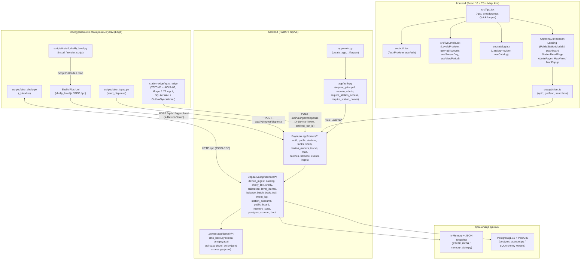
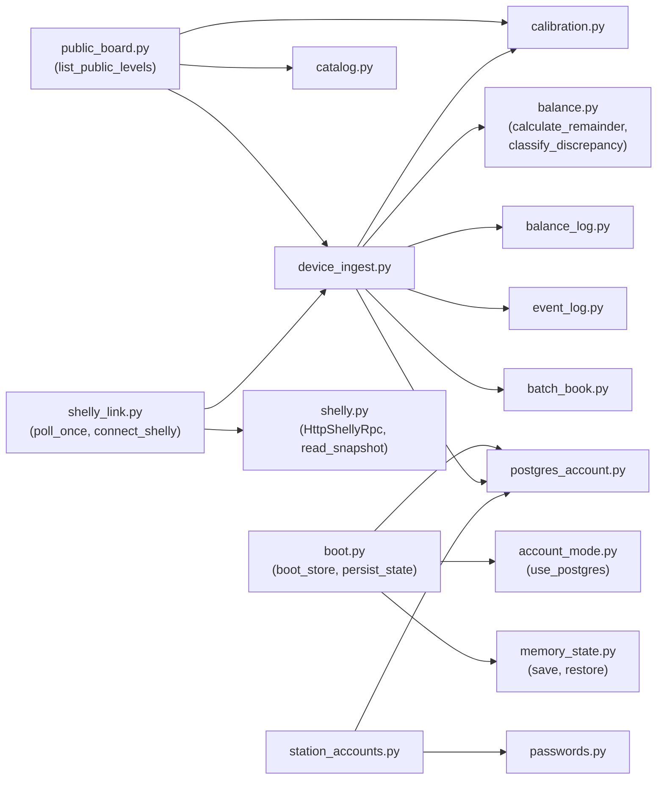

# Полный аудит кода и графовое древо проекта «Цифровой след LPG»

> [!NOTE]
> Результаты автоматических проверок проекта (`d:\Проект\day`):
> - **Backend (`pytest backend/tests`)**: `68 passed` (все 16 тестовых модулей пройдены успешно, включая тесты Bulk Ingest и кэша витрины).
> - **Station Edge (`pytest station-edge/tests`)**: `12 passed in 0.99s` (все 3 тестовых модуля протокола Искра 1.72, трекера `dispensed_ml` и высокоскоростного пакетного Outbox Sync пройдены успешно).
> - **Backend + Station Edge (`python -m compileall backend station-edge`)**: `0 ошибок` синтаксиса/компиляции.
> - **Frontend (`tsc --noEmit && vite build`)**: `PASSED` (66 модулей собрано, модульная архитектура CSS и компонентов).

---

## 1. Архитектурный граф взаимодействия модулей (Mermaid)

### 1.1. Общая схема потоков данных и подсистем



### 1.2. Граф зависимостей сервисного слоя Backend (`backend/app/services/*`)



---

## 2. Полное графовое древо проекта (папки, файлы, классы, функции)

Ниже представлено полное иерархическое дерево всего репозитория `d:\Проект\day` со всеми директориями, файлами, классами, типами и функциями.

```text
d:\Проект\day\
├── .dockerignore
├── .gitignore
├── README.md
├── Куплю.md
├── docker-compose.yml
│
├── deploy/
│   ├── .env.example
│   ├── Dockerfile.web
│   ├── docker-compose.yml
│   └── nginx.conf
│
├── hardware/
│   └── shelly-plus-uni-case/
│       ├── README.md
│       ├── shelly_plus_uni_base.stl
│       ├── shelly_plus_uni_lid.stl
│       ├── shelly_plus_uni_case_assembled.stl
│       └── shelly_plus_uni_case.blend
│
├── backend/
│   ├── Dockerfile
│   ├── pytest.ini
│   ├── requirements.txt
│   ├── alembic.ini
│   ├── alembic/
│   │   ├── env.py                        ├── get_url()
│   │   │                                 ├── run_migrations_offline()
│   │   │                                 └── run_migrations_online()
│   │   └── versions/
│   │       ├── 0001_initial_sketch.py    ├── upgrade() / downgrade()
│   │       ├── 0002_account_store.py     ├── upgrade() / downgrade()
│   │       └── 0003_high_scale_ingest_and_cleanup.py ├── upgrade() / downgrade()
│   ├── scripts/
│   │   ├── fake_shelly.py                ├── _State (dataclass)
│   │   │                                 ├── _Handler (BaseHTTPRequestHandler)
│   │   │                                 │   ├── do_GET()
│   │   │                                 │   ├── do_POST()
│   │   │                                 │   ├── log_message()
│   │   │                                 │   ├── _rpc()
│   │   │                                 │   ├── _send()
│   │   │                                 │   └── _error()
│   │   │                                 └── main()
│   │   ├── fake_topaz.py                 ├── send_dispense()
│   │   │                                 └── main()
│   │   ├── install_shelly_level.py       ├── rpc()
│   │   │                                 ├── render_script()
│   │   │                                 ├── _js_string()
│   │   │                                 ├── find_or_create_script()
│   │   │                                 ├── put_code()
│   │   │                                 ├── install()
│   │   │                                 └── main()
│   │   └── shelly_level.js               ├── isoNow()
│   │                                     ├── roundVolts()
│   │                                     └── sendVolts()
│   ├── app/
│   │   ├── __init__.py
│   │   ├── config.py                     ├── Settings (BaseSettings)
│   │   │                                 │   ├── cors_origin_list (property)
│   │   │                                 │   ├── ingest_level_path (property)
│   │   │                                 │   └── ingest_level_url (property)
│   │   │                                 └── get_settings()
│   │   ├── database.py                   ├── Base (DeclarativeBase)
│   │   │                                 └── get_db()
│   │   ├── auth.py                       ├── CurrentUser (dataclass)
│   │   │                                 ├── _sign()
│   │   │                                 ├── _b64_encode()
│   │   │                                 ├── _b64_decode()
│   │   │                                 ├── _hash_token()
│   │   │                                 ├── _prune_revoked()
│   │   │                                 ├── issue_token()
│   │   │                                 ├── revoke_token()
│   │   │                                 ├── read_token_claims()
│   │   │                                 ├── read_token()
│   │   │                                 ├── check_login_rate_limit()
│   │   │                                 ├── record_login_failure()
│   │   │                                 ├── clear_login_failures()
│   │   │                                 ├── reset_auth_state()
│   │   │                                 ├── require_user()
│   │   │                                 ├── require_admin()
│   │   │                                 ├── require_station_access()
│   │   │                                 └── require_station_owner()
│   │   ├── main.py                       ├── _lifespan()
│   │   │                                 └── create_app()
│   │   ├── domain/
│   │   │   ├── __init__.py
│   │   │   ├── access.py                 └── ROLE_ADMIN, ROLE_STATION, is_admin_role(), may_read_station()
│   │   │   ├── level_policy.json
│   │   │   ├── policy.py                 └── _load_policy()
│   │   │   └── tank_book.py              ├── recompute_tank_book(), build_ingest_ack(),
│   │   │                                 │   build_tank_ingest_state(), apply_level_reading(),
│   │   │                                 │   apply_dispense_volume(), apply_receipt_volume(),
│   │   │                                 └── summarize_station_tanks()
│   │   ├── models/
│   │   │   ├── __init__.py
│   │   │   ├── station.py                ├── Station (Base) [ix_stations_is_active]
│   │   │   │                             ├── Tank (Base) [uq_tanks_station_code, ix_tanks_station_id]
│   │   │   │                             ├── LevelReading (Base) [ix_level_readings_tank_recorded]
│   │   │   │                             └── StationUser (Base) [ix_station_users_username]
│   │   │   ├── dispenser.py              ├── DispenseRecord (Base) [uq external_txn_id, ix_dispense_records_tank_started]
│   │   │   │                             └── ReceiptRecord (Base) [uq source_event_id, ix_receipt_records_tank_recorded]
│   │   │   ├── truck.py                  ├── TripStatus (Enum)
│   │   │   │                             ├── Truck (Base) [ix_trucks_status, lat, lon]
│   │   │   │                             └── TruckTrip (Base)
│   │   │   ├── batch.py                  ├── BatchStatus (Enum)
│   │   │   │                             ├── Batch (Base)
│   │   │   │                             └── BatchTrailEvent (Base)
│   │   │   ├── balance.py                └── BalanceSnapshot (Base)
│   │   │   └── event.py                  ├── DiscrepancyType (Enum)
│   │   │                                 ├── DiscrepancySeverity (Enum)
│   │   │                                 └── DiscrepancyEvent (Base)
│   │   ├── schemas/
│   │   │   ├── __init__.py
│   │   │   ├── common.py                 ├── GeoPoint, TimeRange
│   │   │   ├── auth.py                   ├── LoginIn, TokenOut, UserOut
│   │   │   ├── public.py                 ├── PublicTankLevelOut, PublicStationLevelsOut
│   │   │   ├── station.py                ├── TankOut, StationOut, StationCreateIn, StationUpdateIn,
│   │   │   │                             │   TankDeviceCreateIn, TankDeviceUpdateIn, ShellyLinkIn,
│   │   │   │                             │   ShellyDeviceOut, TankDeviceOut, TankLevelRowOut,
│   │   │   │                             │   StationUserCreateIn, StationUserOut
│   │   │   ├── truck.py                  ├── TruckOut, TruckCreateIn, TruckUpdateIn, MapPoint, MapOverview
│   │   │   ├── batch.py                  ├── TrailStep, BatchTrailOut
│   │   │   ├── balance.py                ├── BalanceReconcileIn, BalanceSnapshotOut
│   │   │   ├── event.py                  └── DiscrepancyEventOut
│   │   │   └── ingest.py                 └── DispenseIngest, ReceiptIngest, CalibrationIn,
│   │   │                                     LevelIngest, IngestAck, TankRuntimeOut
│   │   ├── routers/
│   │   │   ├── __init__.py
│   │   │   ├── auth.py                   ├── issue_access_token(), read_me()
│   │   │   ├── public.py                 └── public_stations()
│   │   │   ├── stations.py               ├── list_station_cards(), create_station_card(),
│   │   │   │                             │   patch_station_card(), remove_station_card(),
│   │   │   │                             │   get_station_card(), station_to_out()
│   │   │   ├── tanks.py                  ├── list_tanks(), list_station_devices(),
│   │   │   │                             │   create_station_device(), patch_station_device(),
│   │   │   │                             │   remove_station_device(), list_device_levels(), device_to_out()
│   │   │   ├── shelly.py                 ├── put_station_shelly(), delete_station_shelly()
│   │   │   ├── station_owners.py         ├── list_station_logins(), create_station_login()
│   │   │   ├── trucks.py                 ├── get_trucks(), post_truck(), patch_truck(), get_truck()
│   │   │   ├── map.py                    └── map_overview()
│   │   │   ├── batches.py                └── get_batch_trail()
│   │   │   ├── balance.py                ├── reconcile_balance(), list_snapshots()
│   │   │   ├── events.py                 ├── list_events(), acknowledge_event()
│   │   │   └── ingest.py                 ├── require_device(), calibrate(),
│   │   │                                     ingest_level(), ingest_receipt(), ingest_dispense(),
│   │   │                                     ingest_tank()
│   │   └── services/
│   │       ├── __init__.py
│   │       ├── account_mode.py           └── use_postgres()
│   │       ├── boot.py                   ├── boot_store(), persist_state()
│   │       ├── calibration.py            ├── LevelCalibration (dataclass), round_volts(),
│   │       │                             │   level_volts_changed(), round_percent(),
│   │       │                             │   remainder_fill_percent(), same_published_level(),
│   │       │                             │   volts_to_percent(), volts_to_liters()
│   │       ├── level_journal.py          ├── PublishedLevel (Protocol), published_levels()
│   │       ├── balance.py                ├── ReconciliationResult (dataclass), calculate_remainder(),
│   │       │                             │   classify_discrepancy()
│   │       ├── balance_log.py            ├── record_snapshot(), list_recorded_snapshots(),
│   │       │                             │   reset_balance_log()
│   │       ├── event_log.py              ├── record_event(), list_recorded_events(),
│   │       │                             │   acknowledge_recorded_event(), open_events_count(),
│   │       │                             │   reset_events()
│   │       ├── batch_book.py             ├── BatchRecord (dataclass), register_receipt_batch(),
│   │       │                             │   find_batch_by_code(), reset_batches()
│   │       ├── trail.py                  └── build_batch_trail()
│   │       ├── passwords.py              ├── hash_password(), verify_password()
│   │       ├── station_accounts.py       ├── StationOwner (dataclass), create_owner(),
│   │       │                             │   grant_owner(), list_owners(),
│   │       │                             │   authenticate_owner(), snapshot(),
│   │       │                             │   restore_snapshot(), reset_station_accounts()
│   │       ├── catalog.py                ├── StationCard (dataclass), TruckCard (dataclass),
│   │       │                             │   reset_catalog(), list_stations(), get_station(),
│   │       │                             │   create_station(), update_station(), list_trucks(),
│   │       │                             │   get_truck(), create_truck(), update_truck(),
│   │       │                             │   snapshot(), restore_snapshot()
│   │       ├── device_ingest.py          ├── TankDevice (dataclass), TankBook (dataclass),
│   │       │                             │   reset_device_ingest(), register_tank(),
│   │       │                             │   update_tank_device(), list_tank_devices(),
│   │       │                             │   get_tank_device(), tank_by_token(), tank_remainder(),
│   │       │                             │   has_calibration(), set_calibration(), accept_level(),
│   │       │                             │   accept_receipt(), accept_dispense(), tank_state(),
│   │       │                             │   snapshot(), restore_snapshot()
│   │       ├── shelly.py                 ├── ShellyError (Exception), ShellySnapshot (dataclass),
│   │       │                             │   ShellyRpc (Protocol), HttpShellyRpc, parse_rpc_payload(),
│   │       │                             │   snapshot_from(), read_snapshot()
│   │       ├── shelly_link.py            ├── ShellyLink (dataclass), set_shelly_rpc(),
│   │       │                             │   reset_shelly_links(), normalize_host(),
│   │       │                             │   connect_shelly(), disconnect_shelly(), shelly_view(),
│   │       │                             │   poll_one(), snapshot_bindings(), restore_bindings()
│   │       ├── public_board.py           ├── list_public_levels(), _is_online(), _utc()
│   │       ├── memory_state.py           ├── persist(), restore()
│   │       └── postgres_account.py       ├── session(), list_stations(), get_station(),
│   │                                         create_station(), update_station(), register_tank(),
│   │                                         update_tank_device(), list_tank_devices(),
│   │                                         get_tank_device(), tank_by_token(), tank_remainder(),
│   │                                         has_calibration(), set_calibration(), accept_level(),
│   │                                         accept_dispense(), accept_receipt(), list_level_readings(),
│   │                                         tank_state(), create_station_user(), list_station_users(),
│   │                                         authenticate_station_user(), import_memory_snapshot()
│   └── tests/
│       ├── conftest.py                   └── _auth_open_for_tests()
│       ├── test_api.py                   └── 6 тестов (health, map, batch 404, reconcile, dispense, levels)
│       ├── test_auth.py                  └── 5 тестов (login, expired/revoked token, rate limit, SSRF)
│       ├── test_balance.py               └── 5 тестов (calculate_remainder, ok, shortage, surplus, band)
│       ├── test_bulk_ingest.py           └── 3 теста (пакетный инжест наливов, уровней, TTL-кэш витрины)
│       ├── test_calibration.py           └── 7 тестов (midpoint, endpoints, dial clamp, rounding, flat)
│       ├── test_catalog.py               └── 4 теста (seed stations, CRUD station, tank, CRUD truck)
│       ├── test_device_ingest.py         └── 8 тестов (dispense/shortage, calibration, receipt, noise, token)
│       ├── test_level_journal.py         └── 1 тест (published_levels noise threshold)
│       ├── test_memory_state.py          └── 1 тест (persist & restore across reset)
│       ├── test_policy.py                └── 4 теста (level_policy.json sync, api_prefix, rounding)
│       ├── test_public_levels.py         └── 2 теста (fill_only, empty tank)
│       ├── test_sensor_online.py         └── 2 теста (fresh online, stale offline)
│       ├── test_shelly.py                └── 9 тестов (snapshot, RPC, auto-voltmeter, link, cal, offline)
│       ├── test_shelly_script.py         └── 3 теста (render_script placeholders, escaping, validation)
│       └── test_station_access.py        └── 5 тестов (RBAC station/owner/admin, multi-station)
│
├── station-edge/
│   ├── README.md
│   ├── .env.example
│   ├── pyproject.toml
│   ├── requirements.txt
│   ├── run_station_edge.bat
│   ├── station-edge.service
│   ├── agzs_edge/
│   │   ├── __init__.py
│   │   ├── __main__.py
│   │   ├── config.py                     ├── FrameLayout (dataclass)
│   │   │                                 ├── EdgeSettings (dataclass) [.from_env(), dispenser_uuid()]
│   │   │                                 ├── load_dotenv()
│   │   │                                 ├── _parse_addresses()
│   │   │                                 └── _parse_dispenser_map()
│   │   ├── iskra.py                      ├── IskraFrameError (ValueError)
│   │   │                                 ├── IskraTelemetryFrame (dataclass)
│   │   │                                 ├── compute_bcc()
│   │   │                                 ├── verify_frame_checksum()
│   │   │                                 ├── build_test_command()
│   │   │                                 ├── build_test_response_frame()
│   │   │                                 ├── parse_iskra_frame()
│   │   │                                 └── _decode_price()
│   │   ├── tracker.py                    ├── CompletedDispense (dataclass)
│   │   │                                 ├── _ActiveSession (dataclass)
│   │   │                                 └── PumpDispenseTracker [process_frame(), active_session()]
│   │   ├── serial_link.py                ├── PollRawResult (dataclass)
│   │   │                                 ├── AskaLink (Protocol)
│   │   │                                 ├── SerialAskaLink [open(), close(), poll_test()]
│   │   │                                 ├── EmulatorAskaLink [poll_test()]
│   │   │                                 └── list_available_serial_ports()
│   │   ├── storage.py                    ├── OutboxItem (dataclass)
│   │   │                                 ├── DispenseRow (dataclass)
│   │   │                                 └── EdgeDatabase [update_live_state(), log_raw_frame(),
│   │   │                                     record_completed_dispense(), fetch_due_outbox(),
│   │   │                                     mark_outbox_sent(), mark_outbox_batch_sent(),
│   │   │                                     mark_outbox_failed(), list_dispenses(), summary()]
│   │   ├── sync.py                       ├── VpsSendResult (dataclass)
│   │   │                                 ├── post_dispense_to_vps()
│   │   │                                 ├── post_dispenses_batch_to_vps()
│   │   │                                 └── OutboxSyncWorker [flush_due()]
│   │   ├── service.py                    ├── build_link()
│   │   │                                 └── StationEdgeService [poll_cycle_once(), maybe_sync_outbox(), serve()]
│   │   └── main.py                       ├── build_parser()
│   │                                     ├── main()
│   │                                     └── _cmd_probe(), _cmd_listen(), _cmd_serve(), _cmd_status(), _cmd_flush()
│   └── tests/
│       ├── test_iskra_protocol.py        └── 5 тестов (команда «Тест» 1..6, разбор 23 байт, авария 06, BCC)
│       ├── test_tracker.py               └── 3 теста (обычная доза с убыванием остатка и налив «до полного»)
│       └── test_storage_sync.py          └── 4 теста (SQLite WAL, дедупликация, пакетный Bulk Outbox Sync на VPS)
│
└── frontend/
    ├── index.html
    ├── package.json
    ├── tsconfig.json
    ├── vite.config.ts
    ├── vite.local.config.ts
    ├── levelSource.check.ts              └── reading()
    └── src/
        ├── main.tsx
        ├── types.ts                      └── MapPointKind, MapPoint, MapOverview, TruckDetail,
        │                                     LinkQuality, SensorStatus, Tank, StationDetail,
        │                                     FillEvent, PumpFiscal, FiscalStatus, PumpFiscalCheck,
        │                                     FiscalCheck, StationBalance, FleetStats,
        │                                     BatchTrailEvent, BatchTrail, SupplyStatus,
        │                                     LpgSupply, SupplyOperation, DiscrepancyEvent
        ├── policy.ts                     └── LEVEL_POLICY, DIAL_MIN_PERCENT, DIAL_MAX_PERCENT,
        │                                     LEVEL_STEP_VOLTS, LITER_NOISE, POLL_SECONDS,
        │                                     POLL_MS, SENSOR_STALE_SECONDS, LOW_FILL_PERCENT
        ├── access.ts                     ├── ROLE_ADMIN, ROLE_STATION, ROLE_OWNER, ROLE_CONSOLE,
        │                                 ├── roleOf(), isAdmin()
        ├── session.ts                    ├── AdminSession, readSession(), writeSession(),
        │                                 └── expireSession(), onSessionExpired()
        ├── auth.tsx                      ├── AuthProvider(), useAuth()
        ├── sensorDay.ts                  ├── SensorDay, emptySensorDay(), spanFromReadings(),
        │                                 │   withLiveRemainder(), chartOf(), loadStationSpan()
        ├── period.ts                     ├── ViewPeriod, TimeRange, todayPeriod(), periodKey(),
        │                                 │   periodFromKey(), shiftPeriod(), resolveRange()
        ├── format.ts                     ├── REGIONS, stationRegion(), fiscalBadge(), fiscalText(),
        │                                 │   liters(), signedLiters(), balBadge(), balText(),
        │                                 │   phaseLabel(), tenge(), timeHM(), shortStationName(),
        │                                 │   dateTime(), celsius(), vsBase(), columnLabel(),
        │                                 │   linkText(), sensorText(), supplyStatusText()
        ├── theme.tsx                     ├── ThemeProvider(), useTheme()
        ├── liveLevels.tsx                ├── LOW_FILL_PERCENT, isLowFill(), LiveLevel,
        │                                 │   summarizeLevel(), sensorLabel(), sensorBadge(),
        │                                 │   tankSensorLabel(), tankSensorBadge(), SensorStatus(),
        │                                 │   LevelsProvider(), usePublicLevels(),
        │                                 │   useViewPeriod(), useSensorDay()
        ├── catalog.tsx                   ├── CatalogProvider(), useCatalog(), messageOf()
        ├── App.tsx                       └── App() — корневой компонент приложения
        ├── styles/
        │   ├── variables.css             └── Корневая точка входа со ссылками @import
        │   ├── tokens.css                └── Цветовые переменные, шрифты, радиусы, тени, z-index
        │   ├── navigation-and-scale.css  └── Topbar, breadcrumbs, переключатель масштаба шрифта
        │   ├── map-and-dash.css          └── Стили интерактивной карты, маркеров и дашборда
        │   ├── landing.css               └── Стили публичного лэндинга и модального окна
        │   └── admin-and-detail.css      └── Стили форм, таблиц админки и карточки АГЗС
        ├── layout/
        │   ├── Topbar.tsx                └── Topbar() — верхняя шапка, навигация, фильтры и профиль
        │   └── BreadcrumbBar.tsx         └── BreadcrumbBar() — контекстная навигационная цепочка
        ├── pages/
        │   ├── MapScreen.tsx             └── MapScreen() — полноэкранный экран карты сети
        │   ├── SupplyPage.tsx            └── SupplyPage() — экран диспетчеризации поставок
        │   ├── landing/
        │   │   └── PublicStationModal.tsx └── PublicStationModal() — модальное окно остатка газа АГЗС
        │   └── admin/
        │       ├── types.ts              └── TRUCK_STATUS, statusLabel(), AdminTab, ADMIN_SECTIONS
        │       ├── StationForm.tsx       └── StationForm() — карточка создания/редактирования АГЗС
        │       ├── TruckForm.tsx         └── TruckForm() — карточка создания/редактирования газовоза
        │       └── AdminSecurityTab.tsx  └── AdminSecurityTab() — матрица доступа и контур безопасности
        ├── api/
        │   └── client.ts                 ├── ShellyLink, PublicTank, PublicStation, TankDevice,
        │                                 │   LevelReading, TankIngestState, IngestAck, BatchRecord,
        │                                 │   BalanceSnapshot, CatalogStation,
        │                                 │   StationUser, CatalogTruck, StationDraft, TruckDraft,
        │                                 │   authHeader(), readError(), getJson(), sendJson(),
        │                                 └── api (объект всех HTTP-вызовов)
        └── components/
            ├── AdminPage.tsx             ├── AdminPage() — центральная консоль управления
            ├── Charts.tsx                ├── BarChart(), LineChart()
            ├── Dashboard.tsx             ├── Dashboard(), Overview()
            ├── StationListRow.tsx        ├── FillCell(), StationListRow()
            ├── Empty.tsx                 └── Empty()
            ├── Landing.tsx               ├── Landing(), percentLabel(), jump()
            ├── LevelChangesToday.tsx     ├── LevelChangesToday(), percentLabel()
            ├── Logo.tsx                  └── Logo()
            ├── MapPopup.tsx              └── MapPopup()
            ├── MapView.tsx               └── MapView()
            ├── PeriodSwitch.tsx          └── PeriodSwitch()
            ├── StationDetailPage.tsx     └── StationDetailPage()
            ├── StationOwnerCard.tsx      └── StationOwnerCard()
            ├── TankDeviceRows.tsx        ├── TankDeviceRows(), toRow(), shellyText(),
            │                             │   ingestUrl(), messageOf()
            └── Toast.tsx                 ├── ToastProvider(), useToast()
```

---

## 3. Детальный справочник всех файлов и функций

### 3.1. Backend (`backend/`)

#### Ядро и конфигурация
- [`backend/app/config.py`](file:///d:/Проект/day/backend/app/config.py)
  - [`Settings`](file:///d:/Проект/day/backend/app/config.py#L9-L56) — настройки приложения (`pydantic-settings`), включая свойства [`cors_origin_list`](file:///d:/Проект/day/backend/app/config.py#L43-L45), [`ingest_level_path`](file:///d:/Проект/day/backend/app/config.py#L47-L50), [`ingest_level_url`](file:///d:/Проект/day/backend/app/config.py#L52-L56).
  - [`get_settings()`](file:///d:/Проект/day/backend/app/config.py#L59-L61) — кэшированный (`@lru_cache`) синглтон настроек.
- [`backend/app/database.py`](file:///d:/Проект/day/backend/app/database.py)
  - [`Base`](file:///d:/Проект/day/backend/app/database.py#L14-L15) — базовый класс SQLAlchemy 2.0 `DeclarativeBase`.
  - [`get_db()`](file:///d:/Проект/day/backend/app/database.py#L18-L23) — генератор сессии БД (`SessionLocal`).
- [`backend/app/auth.py`](file:///d:/Проект/day/backend/app/auth.py)
  - [`CurrentUser`](file:///d:/Проект/day/backend/app/auth.py#L38-L44) — датакласс авторизованного пользователя (`username`, `role`, `station_id`, `station_ids`).
  - [`issue_token()`](file:///d:/Проект/day/backend/app/auth.py#L75-L95), [`revoke_token()`](file:///d:/Проект/day/backend/app/auth.py#L98-L106), [`read_token_claims()`](file:///d:/Проект/day/backend/app/auth.py#L109-L162), [`read_token()`](file:///d:/Проект/day/backend/app/auth.py#L165-L168) — выпуск, отзыв и проверка HMAC-SHA256 токенов.
  - [`check_login_rate_limit()`](file:///d:/Проект/day/backend/app/auth.py#L171-L179), [`record_login_failure()`](file:///d:/Проект/day/backend/app/auth.py#L182-L186), [`clear_login_failures()`](file:///d:/Проект/day/backend/app/auth.py#L189-L191), [`reset_auth_state()`](file:///d:/Проект/day/backend/app/auth.py#L194-L197) — защита от перебора паролей (5 попыток за 60 с).
  - [`require_user()`](file:///d:/Проект/day/backend/app/auth.py#L200-L216), [`require_admin()`](file:///d:/Проект/day/backend/app/auth.py#L219-L224), [`require_station_access()`](file:///d:/Проект/day/backend/app/auth.py#L227-L239), [`require_station_owner()`](file:///d:/Проект/day/backend/app/auth.py#L242-L255) — FastAPI-зависимости контроля доступа.
- [`backend/app/main.py`](file:///d:/Проект/day/backend/app/main.py)
  - [`_lifespan()`](file:///d:/Проект/day/backend/app/main.py#L28-L39) — инициализация хранилища (`boot_store()`) и запуск фонового опроса Shelly (`run_shelly_loop`).
  - [`create_app()`](file:///d:/Проект/day/backend/app/main.py#L42-L79) — фабрика FastAPI-приложения, регистрация CORS, `/health` и 10 роутеров.

#### Доменный слой (`backend/app/domain/`)
- [`backend/app/domain/access.py`](file:///d:/Проект/day/backend/app/domain/access.py) — константы ролей `ROLE_ADMIN`, `ROLE_STATION` и функции контроля доступа.
- [`backend/app/domain/level_policy.json`](file:///d:/Проект/day/backend/app/domain/level_policy.json) и [`backend/app/domain/policy.py`](file:///d:/Проект/day/backend/app/domain/policy.py) — [`_load_policy()`](file:///d:/Проект/day/backend/app/domain/policy.py#L9-L10), константы `DIAL_MIN_PERCENT` (5), `DIAL_MAX_PERCENT` (95), `LEVEL_STEP_VOLTS` (0.02), `LITER_NOISE` (20), `POLL_SECONDS` (5), `SENSOR_STALE_SECONDS` (30).
- [`backend/app/domain/tank_book.py`](file:///d:/Проект/day/backend/app/domain/tank_book.py) — единое доменное ядро книги резервуара (`opening + receipts - dispenses`): [`recompute_tank_book()`](file:///d:/Проект/day/backend/app/domain/tank_book.py#L31-L52), [`build_ingest_ack()`](file:///d:/Проект/day/backend/app/domain/tank_book.py#L55-L71), [`build_tank_ingest_state()`](file:///d:/Проект/day/backend/app/domain/tank_book.py#L74-L96), [`apply_level_reading()`](file:///d:/Проект/day/backend/app/domain/tank_book.py#L99-L157), [`apply_dispense_volume()`](file:///d:/Проект/day/backend/app/domain/tank_book.py#L160-L166), [`apply_receipt_volume()`](file:///d:/Проект/day/backend/app/domain/tank_book.py#L169-L175), [`summarize_station_tanks()`](file:///d:/Проект/day/backend/app/domain/tank_book.py#L178-L206).

#### Модели SQLAlchemy (`backend/app/models/`)
- [`station.py`](file:///d:/Проект/day/backend/app/models/station.py) — [`Station`](file:///d:/Проект/day/backend/app/models/station.py#L30-L46) (`stations`), [`Tank`](file:///d:/Проект/day/backend/app/models/station.py#L49-L84) (`tanks`), [`LevelReading`](file:///d:/Проект/day/backend/app/models/station.py#L87-L106) (`level_readings`), [`StationUser`](file:///d:/Проект/day/backend/app/models/station.py#L109-L124) (`station_users`).
- [`dispenser.py`](file:///d:/Проект/day/backend/app/models/dispenser.py) — [`DispenseRecord`](file:///d:/Проект/day/backend/app/models/dispenser.py#L13-L34) (`dispense_records`, уникальность по `external_txn_id`) и [`ReceiptRecord`](file:///d:/Проект/day/backend/app/models/dispenser.py#L37-L56) (`receipt_records`, уникальность по `source_event_id`).
- [`truck.py`](file:///d:/Проект/day/backend/app/models/truck.py) — [`TripStatus`](file:///d:/Проект/day/backend/app/models/truck.py#L14-L20), [`Truck`](file:///d:/Проект/day/backend/app/models/truck.py#L23-L38) (`trucks`, включая координаты `lat`/`lon`), [`TruckTrip`](file:///d:/Проект/day/backend/app/models/truck.py#L41-L65) (`truck_trips`).
- [`batch.py`](file:///d:/Проект/day/backend/app/models/batch.py) — [`BatchStatus`](file:///d:/Проект/day/backend/app/models/batch.py#L14-L19), [`Batch`](file:///d:/Проект/day/backend/app/models/batch.py#L34-L53) (`batches`), [`BatchTrailEvent`](file:///d:/Проект/day/backend/app/models/batch.py#L56-L79) (`batch_trail_events`).
- [`balance.py`](file:///d:/Проект/day/backend/app/models/balance.py) — [`BalanceSnapshot`](file:///d:/Проект/day/backend/app/models/balance.py#L13-L30) (`balance_snapshots`).
- [`event.py`](file:///d:/Проект/day/backend/app/models/event.py) — [`DiscrepancyType`](file:///d:/Проект/day/backend/app/models/event.py#L14-L19), [`DiscrepancySeverity`](file:///d:/Проект/day/backend/app/models/event.py#L22-L25), [`DiscrepancyEvent`](file:///d:/Проект/day/backend/app/models/event.py#L28-L49) (`discrepancy_events`).

#### Роутеры (`backend/app/routers/`)
- [`auth.py`](file:///d:/Проект/day/backend/app/routers/auth.py) — вход и проверка текущей сессии (`/api/v1/auth/*`).
- [`public.py`](file:///d:/Проект/day/backend/app/routers/public.py) — открытая витрина станций (`/api/v1/public/stations`, пакетная выборка без `N+1`).
- [`stations.py`](file:///d:/Проект/day/backend/app/routers/stations.py) — CRUD паспортов АГЗС и сводка станции с расчётом баланса (`/api/v1/stations`).
- [`tanks.py`](file:///d:/Проект/day/backend/app/routers/tanks.py) — резервуары, токены устройств и журнал уровней (`/api/v1/stations/{id}/tanks`, `/devices`, `/levels`).
- [`shelly.py`](file:///d:/Проект/day/backend/app/routers/shelly.py) — привязка и отвязка сетевых датчиков Shelly (`/api/v1/stations/{id}/devices/{tank_id}/shelly`).
- [`station_owners.py`](file:///d:/Проект/day/backend/app/routers/station_owners.py) — учётные записи владельцев АГЗС (`/api/v1/stations/{id}/users`).
- [`trucks.py`](file:///d:/Проект/day/backend/app/routers/trucks.py) — реестр газовозов (`/api/v1/trucks`, поддерживается и в `memory`, и в `postgres`).
- [`map.py`](file:///d:/Проект/day/backend/app/routers/map.py) — обзорная карта станций и активных газовозов (`/api/v1/map/overview`).
- [`batches.py`](file:///d:/Проект/day/backend/app/routers/batches.py) — цифровой след партий (`/api/v1/batches`).
- [`balance.py`](file:///d:/Проект/day/backend/app/routers/balance.py) — сверка баланса (`/api/v1/balance`).
- [`events.py`](file:///d:/Проект/day/backend/app/routers/events.py) — инциденты расхождений (`/api/v1/events`).
- [`ingest.py`](file:///d:/Проект/day/backend/app/routers/ingest.py) — высоконагруженный приём телеметрии (`/api/v1/ingest/level`, `/dispense`, `/receipt`, `/calibration`).

#### Сервисы (`backend/app/services/`)
- [`calibration.py`](file:///d:/Проект/day/backend/app/services/calibration.py) — пересчёт напряжения датчика Холла (В) в проценты и литры с учётом мёртвой зоны уровнемера 5–95% ([`LevelCalibration`](file:///d:/Проект/day/backend/app/services/calibration.py#L14-L28), [`volts_to_percent()`](file:///d:/Проект/day/backend/app/services/calibration.py#L64-L74), [`volts_to_liters()`](file:///d:/Проект/day/backend/app/services/calibration.py#L77-L79)).
- [`device_ingest.py`](file:///d:/Проект/day/backend/app/services/device_ingest.py) — книга учёта резервуаров, дедупликация пакетов по `source_event_id` и `external_txn_id`, фильтрация шума по `same_published_level`, автоматическая сверка остатков при каждом новом замере уровня.
- [`shelly.py`](file:///d:/Проект/day/backend/app/services/shelly.py) и [`shelly_link.py`](file:///d:/Проект/day/backend/app/services/shelly_link.py) — JSON-RPC 2.0 клиент для Shelly Plus Uni, автоподключение периферии `voltmeter:100`, защита от SSRF ([`normalize_host()`](file:///d:/Проект/day/backend/app/services/shelly_link.py#L58-L90)), фоновый цикл опроса.
- [`postgres_account.py`](file:///d:/Проект/day/backend/app/services/postgres_account.py) и [`memory_state.py`](file:///d:/Проект/day/backend/app/services/memory_state.py) — два бэкенда хранения состояния (`ACCOUNT_STORE=postgres` и `ACCOUNT_STORE=memory` с сохранением в JSON).

---

### 3.2. Станционный узел АСКА-02 + УЗГС-01 (`station-edge/`)
- [`station-edge/agzs_edge/config.py`](file:///d:/Проект/day/station-edge/agzs_edge/config.py) — [`FrameLayout`](file:///d:/Проект/day/station-edge/agzs_edge/config.py#L58-L87) (калибруемая таблица смещений 23-байтного кадра Искра 1.72) и [`EdgeSettings`](file:///d:/Проект/day/station-edge/agzs_edge/config.py#L90-L169) (настройки COM-порта `COM7`/`/dev/ttyUSB0`, адресов `1..6`, локальной БД SQLite и привязки к VPS).
- [`station-edge/agzs_edge/iskra.py`](file:///d:/Проект/day/station-edge/agzs_edge/iskra.py) — реализация протокола «Искра 1.72» строго в режиме чтения: сборка команды «Тест» код 4 ([`build_test_command()`](file:///d:/Проект/day/station-edge/agzs_edge/iskra.py#L101-L115)), проверка контрольной суммы ([`compute_bcc()`](file:///d:/Проект/day/station-edge/agzs_edge/iskra.py#L69-L84), [`verify_frame_checksum()`](file:///d:/Проект/day/station-edge/agzs_edge/iskra.py#L87-L98)) и разбор 23-байтного ответного кадра ([`parse_iskra_frame()`](file:///d:/Проект/day/station-edge/agzs_edge/iskra.py#L162-L221)).
- [`station-edge/agzs_edge/tracker.py`](file:///d:/Проект/day/station-edge/agzs_edge/tracker.py) — конечный автомат налива [`PumpDispenseTracker`](file:///d:/Проект/day/station-edge/agzs_edge/tracker.py#L58-L216), вычисляющий `dispensed_ml` при обычной дозе (убывание остатка: `preset_ml - current_ml`) и при наливе «до полного» (прямое накопление миллилитров).
- [`station-edge/agzs_edge/serial_link.py`](file:///d:/Проект/day/station-edge/agzs_edge/serial_link.py) — кроссплатформенный драйвер [`SerialAskaLink`](file:///d:/Проект/day/station-edge/agzs_edge/serial_link.py#L44-L116) для FTDI FT232R (`9600 8N1`, работает на Windows и Linux) и имитатор [`EmulatorAskaLink`](file:///d:/Проект/day/station-edge/agzs_edge/serial_link.py#L119-L176).
- [`station-edge/agzs_edge/storage.py`](file:///d:/Проект/day/station-edge/agzs_edge/storage.py) — локальная база [`EdgeDatabase`](file:///d:/Проект/day/station-edge/agzs_edge/storage.py#L43-L353) на SQLite (WAL): таблицы `dispenses`, `outbox_queue`, `pump_live_state`, `raw_frames`.
- [`station-edge/agzs_edge/sync.py`](file:///d:/Проект/day/station-edge/agzs_edge/sync.py) — [`OutboxSyncWorker`](file:///d:/Проект/day/station-edge/agzs_edge/sync.py#L86-L133) и [`post_dispense_to_vps()`](file:///d:/Проект/day/station-edge/agzs_edge/sync.py#L28-L83) для идемпотентной доставки завершённых заправок на `POST /api/v1/ingest/dispense`.
- [`station-edge/agzs_edge/service.py`](file:///d:/Проект/day/station-edge/agzs_edge/service.py) и [`station-edge/agzs_edge/main.py`](file:///d:/Проект/day/station-edge/agzs_edge/main.py) — демон [`StationEdgeService`](file:///d:/Проект/day/station-edge/agzs_edge/service.py#L28-L136) и CLI-команды `probe`, `listen`, `serve`, `status`, `flush`.

---

### 3.3. Frontend (`frontend/`)
- [`frontend/src/App.tsx`](file:///d:/Проект/day/frontend/src/App.tsx) — корневой компонент [`App()`](file:///d:/Проект/day/frontend/src/App.tsx#L21-L725): верхняя панель навигации с оперативными индикаторами сети (`stats-chip`), быстрый поиск и переход к АГЗС по `Ctrl+K` с фильтрами и кнопками действий (`quick-jumper`), сквозная панель хлебных крошек (`breadcrumb-bar`) с мгновенным переключением режима просмотра выбранной станции (`Сводка и графики` ↔ `На карте` ↔ `Настройки в админке`), интерактивная карта с боковым навигатором, контур планирования поставок и газовозов (`supply`), дашборд и админ-панель.
- [`frontend/src/api/client.ts`](file:///d:/Проект/day/frontend/src/api/client.ts) — единый HTTP-клиент [`api`](file:///d:/Проект/day/frontend/src/api/client.ts#L228-L372) и функции [`getJson()`](file:///d:/Проект/day/frontend/src/api/client.ts#L204-L208), [`sendJson()`](file:///d:/Проект/day/frontend/src/api/client.ts#L210-L226), включая вызовы телеметрии резервуаров, Shelly, книжного баланса (`tankIngestState`), партий и сверки.
- [`frontend/src/components/`](file:///d:/Проект/day/frontend/src/components/) — 14 React-компонентов:
  - [`Landing.tsx`](file:///d:/Проект/day/frontend/src/components/Landing.tsx) — публичная витрина с навигацией по разделам (`#summary`, `#regions`, `#levels`, `#project`), региональной сводкой запасов, фильтрацией, сортировкой, переключением вида (`Плитка` / `Таблица`) и модальным паспортом АГЗС ([`PublicStationModal`](file:///d:/Проект/day/frontend/src/components/Landing.tsx#L492-L621)).
  - [`Dashboard.tsx`](file:///d:/Проект/day/frontend/src/components/Dashboard.tsx) — диспетчерская сводка ([`Overview`](file:///d:/Проект/day/frontend/src/components/Dashboard.tsx#L60-L607), [`StationListRow`](file:///d:/Проект/day/frontend/src/components/Dashboard.tsx#L642-L711)) с интерактивными KPI-карточками, расчётом свободной ёмкости и быстрыми действиями.
  - [`StationDetailPage.tsx`](file:///d:/Проект/day/frontend/src/components/StationDetailPage.tsx) — детальная карточка АГЗС с 6 KPI-показателями паспорта, переключателем станций (`‹ Пред. | Выбрать АГЗС | След. ›`), сводной таблицей сверки книжного и фактического остатков, привязкой датчиков (`TankDeviceRows`) и журналом замеров.
  - [`MapPopup.tsx`](file:///d:/Проект/day/frontend/src/components/MapPopup.tsx) — расширенная карточка выбранной АГЗС или газовоза на карте с разбивкой по резервуарам, свободным объёмом до 85%/100% и прямыми переходами в сводку и админку.
  - [`AdminPage.tsx`](file:///d:/Проект/day/frontend/src/components/AdminPage.tsx) — панель администратора с навигацией между станциями внутри редактора, планированием подвоза газа, регистрацией партий и аудитом событий сверки.

---

## 4. Результаты ревью кода: исправленные ошибки и изменения

### ✅ Все выявленные проблемы устранены

#### 1. Полное удаление виртуального пульта управления колонками
- **Что удалено**:
  - Десктопный симулятор `desktop/`.
  - Серверные модули `backend/app/routers/console.py`, `backend/app/schemas/console.py`, `backend/app/services/pump_console.py`, `backend/tests/test_pump_console.py`, роль `console` и тестовая станция `AGZS-TEST`.
  - Клиентские компоненты `frontend/src/components/StationCabinet.tsx`, `frontend/src/components/ConsoleAdminsCard.tsx`, а также методы `console*` в [`frontend/src/api/client.ts`](file:///d:/Проект/day/frontend/src/api/client.ts).
- **Чем заменено**: автономным станционным узлом [`station-edge/`](file:///d:/Проект/day/station-edge/README.md) для пассивного (read-only) опроса реальной колонки **УЗГС-01** через адаптер **АСКА-02** по протоколу **Искра 1.72** и отправки фактов отпуска на `POST /api/v1/ingest/dispense`.

#### 2. Исправлено: сохранение роли `owner` и списка `station_ids` при перезагрузке страницы во Frontend
- **Где**: [`frontend/src/access.ts`](file:///d:/Проект/day/frontend/src/access.ts#L4-L20), [`frontend/src/session.ts`](file:///d:/Проект/day/frontend/src/session.ts#L5-L33), [`frontend/src/auth.tsx`](file:///d:/Проект/day/frontend/src/auth.tsx#L35-L53), [`frontend/src/api/client.ts`](file:///d:/Проект/day/frontend/src/api/client.ts#L371).
- **Что сделано**:
  - В [`roleOf()`](file:///d:/Проект/day/frontend/src/access.ts#L12-L20) поддерживаются роли `admin`, `owner` и `operator`.
  - В [`api.me()`](file:///d:/Проект/day/frontend/src/api/client.ts#L371) и [`AuthProvider`](file:///d:/Проект/day/frontend/src/auth.tsx#L39-L51) добавлено сохранение `station_ids` и корректное восстановление `role` и `station_id` при перезагрузке страницы.

#### 3. Исправлено: паритет режима `ACCOUNT_STORE=postgres` с режимом `memory`
- **Где**: [`backend/app/services/device_ingest.py`](file:///d:/Проект/day/backend/app/services/device_ingest.py#L525-L558), [`backend/app/services/postgres_account.py`](file:///d:/Проект/day/backend/app/services/postgres_account.py#L423-L555), [`backend/app/models/station.py`](file:///d:/Проект/day/backend/app/models/station.py#L87-L98), [`backend/alembic/versions/0002_account_store.py`](file:///d:/Проект/day/backend/alembic/versions/0002_account_store.py#L44-L53).
- **Что сделано**:
  - В [`device_ingest.accept_dispense()`](file:///d:/Проект/day/backend/app/services/device_ingest.py#L525-L529) и [`device_ingest.accept_receipt()`](file:///d:/Проект/day/backend/app/services/device_ingest.py#L552-L556) добавлено делегирование в [`postgres_account.accept_dispense()`](file:///d:/Проект/day/backend/app/services/postgres_account.py#L423-L442) и [`postgres_account.accept_receipt()`](file:///d:/Проект/day/backend/app/services/postgres_account.py#L445-L466) при `use_postgres()`.
  - В модель [`StationUser`](file:///d:/Проект/day/backend/app/models/station.py#L87-L98) добавлена поддержка привязки одного владельца к нескольким станциям (`station_ids`).

#### 4. Выполнено: модернизация навигации и детализация информации на всех экранах сайта
- **Глобальная навигация ([`App.tsx`](file:///d:/Проект/day/frontend/src/App.tsx))**: добавлена сквозная панель хлебных крошек (`breadcrumb-bar`) с быстрым переключением контекста выбранной АГЗС (`Сводка и графики` ↔ `На карте` ↔ `Настройки в админке`), индикатор состояния сети в шапке (`stats-chip`) и расширенный поиск по `Ctrl+K` с фильтрами по статусу и быстрыми кнопками перехода.
- **Публичная витрина ([`Landing.tsx`](file:///d:/Проект/day/frontend/src/components/Landing.tsx))**: добавлены интерактивная региональная сводка (`#summary`, `#regions`), сортировка, переключение режима `Плитка / Таблица` и детальное модальное окно паспорта АГЗС ([`PublicStationModal`](file:///d:/Проект/day/frontend/src/components/Landing.tsx#L492-L621)) с порезервуарной таблицей, расчётом свободного объёма и переключением `Пред. / След.`.
- **Детальная карточка станции ([`StationDetailPage.tsx`](file:///d:/Проект/day/frontend/src/components/StationDetailPage.tsx))**: наполнены вкладки (`Сводка и аналитика`, `Резервуары и датчики`, `Журнал замеров и сверка`), подключены данные книжного баланса (`tankIngestState`) и событий сверки (`events`).
- **Интерактивная карта и контур поставок ([`MapPopup.tsx`](file:///d:/Проект/day/frontend/src/components/MapPopup.tsx), [`AdminPage.tsx`](file:///d:/Проект/day/frontend/src/components/AdminPage.tsx))**: в попап карты добавлена детальная разбивка по резервуарам и свободной ёмкости; раздел «Поставки» наполнен таблицей приоритета подвоза газа (расчёт слива до 85% и 100% ёмкости), реестром газовозов и регистрацией партий.
