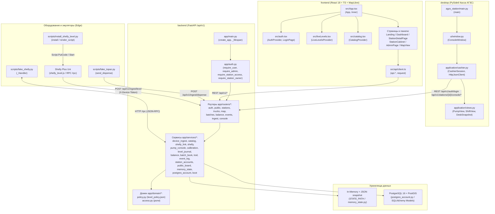
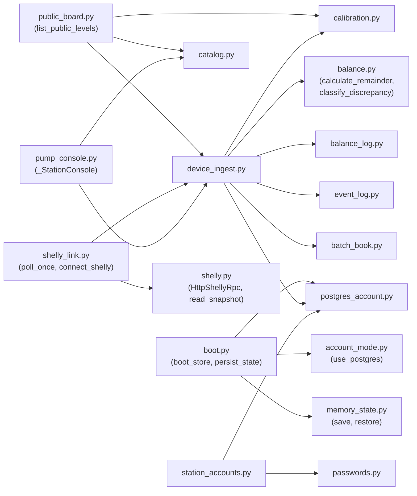

# Полный аудит кода и графовое древо проекта «Цифровой след LPG»

> [!NOTE]
> Результаты автоматических проверок проекта (`d:\Проект\day`):
> - **Backend (`pytest backend/tests`)**: `69 passed in 5.04s` (все 15 тестовых модулей пройдены успешно).
> - **Backend + Desktop (`python -m compileall backend desktop`)**: `0 ошибок` синтаксиса/компиляции.
> - **Frontend (`tsc --noEmit && vite build`)**: `PASSED` (58 модулей собрано за 4.24s, включает проверку [`levelSource.check.ts`](file:///d:/Проект/day/frontend/levelSource.check.ts)).

---

## 1. Архитектурный граф взаимодействия модулей (Mermaid)

### 1.1. Общая схема потоков данных и подсистем



### 1.2. Граф зависимостей сервисного слоя Backend (`backend/app/services/*`)



---

## 2. Полное графовое древо проекта (папки, файлы, классы, функции)

Ниже представлено полное иерархическое дерево всего репозитория `d:\Проект\day` со всеми директориями, файлами, классами, типами и функциями.

```text
d:\Проект\day\
├── .dockerignore
├── .gitignore
├── README.md
├── Куплю.md
├── docker-compose.yml
│
├── deploy/
│   ├── .env.example
│   ├── Dockerfile.web
│   ├── docker-compose.yml
│   └── nginx.conf
│
├── hardware/
│   └── shelly-plus-uni-case/
│       ├── README.md
│       ├── shelly_plus_uni_base.stl
│       ├── shelly_plus_uni_lid.stl
│       ├── shelly_plus_uni_case_assembled.stl
│       └── shelly_plus_uni_case.blend
│
├── backend/
│   ├── Dockerfile
│   ├── pytest.ini
│   ├── requirements.txt
│   ├── alembic.ini
│   ├── alembic/
│   │   ├── env.py                        ├── get_url()
│   │   │                                 ├── run_migrations_offline()
│   │   │                                 └── run_migrations_online()
│   │   └── versions/
│   │       ├── 0001_initial_sketch.py    ├── upgrade()
│   │       │                             └── downgrade()
│   │       └── 0002_account_store.py     ├── upgrade()
│   │                                     └── downgrade()
│   ├── scripts/
│   │   ├── fake_shelly.py                ├── _State (dataclass)
│   │   │                                 ├── _Handler (BaseHTTPRequestHandler)
│   │   │                                 │   ├── do_GET()
│   │   │                                 │   ├── do_POST()
│   │   │                                 │   ├── log_message()
│   │   │                                 │   ├── _rpc()
│   │   │                                 │   ├── _send()
│   │   │                                 │   └── _error()
│   │   │                                 └── main()
│   │   ├── fake_topaz.py                 ├── send_dispense()
│   │   │                                 └── main()
│   │   ├── install_shelly_level.py       ├── rpc()
│   │   │                                 ├── render_script()
│   │   │                                 ├── _js_string()
│   │   │                                 ├── find_or_create_script()
│   │   │                                 ├── put_code()
│   │   │                                 ├── install()
│   │   │                                 └── main()
│   │   └── shelly_level.js               ├── isoNow()
│   │                                     ├── roundVolts()
│   │                                     └── sendVolts()
│   ├── app/
│   │   ├── __init__.py
│   │   ├── config.py                     ├── Settings (BaseSettings)
│   │   │                                 │   ├── cors_origin_list (property)
│   │   │                                 │   ├── ingest_level_path (property)
│   │   │                                 │   └── ingest_level_url (property)
│   │   │                                 └── get_settings()
│   │   ├── database.py                   ├── Base (DeclarativeBase)
│   │   │                                 └── get_db()
│   │   ├── auth.py                       ├── CurrentUser (dataclass)
│   │   │                                 ├── _sign()
│   │   │                                 ├── _b64_encode()
│   │   │                                 ├── _b64_decode()
│   │   │                                 ├── _hash_token()
│   │   │                                 ├── _prune_revoked()
│   │   │                                 ├── issue_token()
│   │   │                                 ├── revoke_token()
│   │   │                                 ├── read_token_claims()
│   │   │                                 ├── read_token()
│   │   │                                 ├── check_login_rate_limit()
│   │   │                                 ├── record_login_failure()
│   │   │                                 ├── clear_login_failures()
│   │   │                                 ├── reset_auth_state()
│   │   │                                 ├── require_user()
│   │   │                                 ├── require_admin()
│   │   │                                 ├── require_station_access()
│   │   │                                 └── require_station_owner()
│   │   ├── main.py                       ├── _lifespan()
│   │   │                                 └── create_app()
│   │   ├── domain/
│   │   │   ├── __init__.py
│   │   │   ├── access.py                 └── ROLE_ADMIN, ROLE_STATION, ROLE_OWNER, ROLE_CONSOLE
│   │   │   ├── level_policy.json
│   │   │   └── policy.py                 └── _load_policy()
│   │   ├── models/
│   │   │   ├── __init__.py
│   │   │   ├── factory.py                └── Factory (Base)
│   │   │   ├── station.py                ├── Station (Base)
│   │   │   │                             ├── Tank (Base)
│   │   │   │                             ├── TankDeviceCredential (Base)
│   │   │   │                             ├── TankReading (Base)
│   │   │   │                             └── StationUser (Base)
│   │   │   ├── dispenser.py              ├── Dispenser (Base)
│   │   │   │                             └── DispenseRecord (Base)
│   │   │   ├── truck.py                  ├── TruckStatus (Enum)
│   │   │   │                             ├── GasTruck (Base)
│   │   │   │                             ├── TruckPosition (Base)
│   │   │   │                             └── TruckTrip (Base)
│   │   │   ├── batch.py                  ├── BatchStatus (Enum)
│   │   │   │                             ├── GasBatch (Base)
│   │   │   │                             └── BatchTrailEvent (Base)
│   │   │   ├── supply.py                 └── SupplyDelivery (Base)
│   │   │   ├── sale.py                   └── SaleTransaction (Base)
│   │   │   ├── balance.py                └── BalanceSnapshot (Base)
│   │   │   └── event.py                  ├── DiscrepancyType (Enum)
│   │   │                                 ├── EventSeverity (Enum)
│   │   │                                 └── DiscrepancyEvent (Base)
│   │   ├── schemas/
│   │   │   ├── __init__.py
│   │   │   ├── common.py                 ├── GeoPoint, TimeRange
│   │   │   ├── auth.py                   ├── LoginIn, TokenOut, UserOut
│   │   │   ├── public.py                 ├── PublicTankLevelOut, PublicStationLevelsOut
│   │   │   ├── station.py                ├── TankOut, StationOut, StationCreateIn, StationUpdateIn,
│   │   │   │                             │   TankDeviceCreateIn, TankDeviceUpdateIn, ShellyLinkIn,
│   │   │   │                             │   ShellyDeviceOut, TankDeviceOut, TankLevelRowOut,
│   │   │   │                             │   StationUserCreateIn, StationUserOut
│   │   │   ├── truck.py                  ├── TruckOut, TruckCreateIn, TruckUpdateIn, MapPoint, MapOverview
│   │   │   ├── batch.py                  ├── TrailStep, BatchTrailOut
│   │   │   ├── balance.py                ├── BalanceReconcileIn, BalanceSnapshotOut
│   │   │   ├── event.py                  └── DiscrepancyEventOut
│   │   │   ├── ingest.py                 ├── DispenseIngest, ReceiptIngest, CalibrationIn,
│   │   │   │                             │   LevelIngest, IngestAck, TankRuntimeOut
│   │   │   └── console.py                ├── ConsoleMode, ConsoleDoseIn, ConsoleStartIn,
│   │   │                                 │   ConsoleLinkIn, ConsoleLatchIn, ConsoleAdvanceIn,
│   │   │                                 │   ConsolePriceIn, ConsolePumpOut, ConsoleShiftOut,
│   │   │                                 │   ConsoleActionOut, ConsoleLogRowOut, ConsoleSnapshotOut,
│   │   │                                 │   ConsoleSaleOut, ConsolePumpTotalOut, ConsoleCabinetOut
│   │   ├── routers/
│   │   │   ├── __init__.py
│   │   │   ├── auth.py                   ├── login(), logout(), me(), _client_ip()
│   │   │   ├── public.py                 └── get_public_levels()
│   │   │   ├── stations.py               ├── get_stations(), post_station(), patch_station(),
│   │   │   │                             │   get_station(), get_station_users(), post_station_user(),
│   │   │   │                             │   delete_station_user(), get_station_devices(),
│   │   │   │                             │   get_station_device_levels(), post_station_device(),
│   │   │   │                             │   patch_station_device(), put_station_device_shelly(),
│   │   │   │                             │   delete_station_device_shelly(), _require_station(),
│   │   │   │                             │   _device_out(), _shelly_out(), _user_out()
│   │   │   ├── trucks.py                 ├── get_trucks(), post_truck(), patch_truck(), get_truck()
│   │   │   ├── map.py                    └── get_map_overview()
│   │   │   ├── batches.py                └── get_batch_trail()
│   │   │   ├── balance.py                ├── reconcile_balance(), list_snapshots()
│   │   │   ├── events.py                 ├── list_events(), acknowledge_event()
│   │   │   ├── ingest.py                 ├── _check_token(), _resolve_tank_token(), put_calibration(),
│   │   │   │                             │   ingest_level(), ingest_receipt(), ingest_dispense(),
│   │   │   │                             │   get_tank_state()
│   │   │   └── console.py                ├── _require_station(), _action(), get_console(),
│   │   │                                 │   get_console_cabinet(), put_console_price(),
│   │   │                                 │   get_console_admins(), post_console_admin(),
│   │   │                                 │   delete_console_admin(), get_console_logs(),
│   │   │                                 │   post_open_shift(), post_close_shift(), post_preset(),
│   │   │                                 │   post_clear_preset(), post_start(), post_stop(),
│   │   │                                 │   post_hold(), post_release(), post_reset(),
│   │   │                                 │   post_link(), post_commands(), post_advance()
│   │   └── services/
│   │       ├── __init__.py
│   │       ├── account_mode.py           └── use_postgres()
│   │       ├── boot.py                   ├── boot_store(), persist_state()
│   │       ├── calibration.py            ├── LevelCalibration (dataclass), round_volts(),
│   │       │                             │   level_volts_changed(), round_percent(),
│   │       │                             │   remainder_fill_percent(), same_published_level(),
│   │       │                             │   volts_to_percent(), volts_to_liters()
│   │       ├── level_journal.py          ├── PublishedLevel (Protocol), published_levels()
│   │       ├── balance.py                ├── ReconciliationResult (dataclass), calculate_remainder(),
│   │       │                             │   classify_discrepancy()
│   │       ├── balance_log.py            ├── record_snapshot(), list_recorded_snapshots(),
│   │       │                             │   reset_balance_log()
│   │       ├── event_log.py              ├── record_event(), list_recorded_events(),
│   │       │                             │   acknowledge_recorded_event(), open_events_count(),
│   │       │                             │   reset_events()
│   │       ├── batch_book.py             ├── BatchRecord (dataclass), register_receipt_batch(),
│   │       │                             │   find_batch_by_code(), reset_batches()
│   │       ├── trail.py                  └── build_batch_trail()
│   │       ├── passwords.py              ├── hash_password(), verify_password()
│   │       ├── station_accounts.py       ├── StationCredential (dataclass), create_station_account(),
│   │       │                             │   create_console_account(), ensure_default_console_account(),
│   │       │                             │   list_station_accounts(), list_console_accounts(),
│   │       │                             │   delete_station_account(), delete_console_account(),
│   │       │                             │   authenticate_station_account(), dump_station_accounts(),
│   │       │                             │   load_station_accounts(), reset_station_accounts(),
│   │       │                             │   _create_account(), _list_accounts(), _delete_account()
│   │       ├── catalog.py                ├── StationRecord (dataclass), TruckRecord (dataclass),
│   │       │                             │   reset_catalog(), ensure_console_station(),
│   │       │                             │   list_stations(), get_station(), create_station(),
│   │       │                             │   update_station(), list_trucks(), get_truck(),
│   │       │                             │   create_truck(), update_truck(), dump_catalog(),
│   │       │                             │   load_catalog(), _seed_stations(), _persist()
│   │       ├── device_ingest.py          ├── RegisteredTank (dataclass), LevelLogRow (dataclass),
│   │       │                             │   _TankBook (dataclass), reset_device_ingest(),
│   │       │                             │   register_tank(), update_registered_tank(),
│   │       │                             │   list_station_tanks(), get_registered_tank(),
│   │       │                             │   tank_by_token(), tank_remainder(), tank_calibration(),
│   │       │                             │   list_tank_levels(), set_calibration(), accept_level(),
│   │       │                             │   accept_receipt(), accept_dispense(), tank_state(),
│   │       │                             │   dump_device_ingest(), load_device_ingest(),
│   │       │                             │   _book(), _sync_from_device(), _remember(),
│   │       │                             │   _resolve_tank_for_dispense(), _reconcile(),
│   │       │                             │   _open_event(), _ack(), _append_level_row(), _persist()
│   │       ├── shelly.py                 ├── ShellyError (Exception), ShellySnapshot (dataclass),
│   │       │                             │   ShellyRpc (Protocol), HttpShellyRpc, parse_rpc_payload(),
│   │       │                             │   snapshot_from(), read_snapshot(), _peripheral_ready(),
│   │       │                             │   _restart_required(), _extract_volts(), _str_or_none(),
│   │       │                             │   _model_name(), _wifi_rssi(), _unixtime()
│   │       ├── shelly_link.py            ├── ShellyLink (dataclass), set_shelly_rpc(),
│   │       │                             │   reset_shelly_links(), normalize_host(),
│   │       │                             │   connect_shelly(), disconnect_shelly(), shelly_view(),
│   │       │                             │   poll_tank_shelly(), poll_once(), run_shelly_loop(),
│   │       │                             │   dump_shelly_links(), load_shelly_links(),
│   │       │                             │   _is_forbidden_ip(), _apply_snapshot(), _persist()
│   │       ├── public_board.py           ├── list_public_levels(), _is_online(), _utc()
│   │       ├── pump_console.py           ├── _JournalRow (dataclass), _CompletedSale (dataclass),
│   │       │                             │   _PumpChannel (dataclass), _StationConsole,
│   │       │                             │   cost_kzt(), max_ml_for_prepaid(), parse_user_number(),
│   │       │                             │   preset_kzt(), reset_consoles(), use_manual_clock(),
│   │       │                             │   advance_for_tests(), console_snapshot(),
│   │       │                             │   console_cabinet(), console_set_price(),
│   │       │                             │   console_journal(), console_open_shift(),
│   │       │                             │   console_close_shift(), console_preset(),
│   │       │                             │   console_clear_preset(), console_start(),
│   │       │                             │   console_stop(), console_hold(), console_release(),
│   │       │                             │   console_reset_alarm(), console_set_link(),
│   │       │                             │   console_set_command_latch(), _console_for(),
│   │       │                             │   _now_ms(), _utc_iso()
│   │       ├── memory_state.py           ├── save(), restore()
│   │       └── postgres_account.py       ├── session_scope(), seed_defaults(), list_stations(),
│   │                                     │   get_station(), create_station(), update_station(),
│   │                                     │   register_tank(), update_registered_tank(),
│   │                                     │   list_station_tanks(), get_registered_tank(),
│   │                                     │   tank_by_token(), tank_remainder(), tank_calibration(),
│   │                                     │   set_calibration(), accept_level(), list_tank_levels(),
│   │                                     │   tank_state(), create_station_account(),
│   │                                     │   list_station_accounts(), delete_station_account(),
│   │                                     │   authenticate_station_account(), _station_record(),
│   │                                     │   _registered_tank(), _calibration_from_row(),
│   │                                     │   _require_tank(), _last_reading(), _state_from_row(),
│   │                                     │   _as_utc()
│   └── tests/
│       ├── conftest.py                   └── _auth_open_for_tests()
│       ├── test_api.py                   └── 6 тестов (health, map, batch 404, reconcile, dispense, levels)
│       ├── test_auth.py                  └── 5 тестов (login, expired/revoked token, rate limit, SSRF)
│       ├── test_balance.py               └── 5 тестов (calculate_remainder, ok, shortage, surplus, band)
│       ├── test_calibration.py           └── 7 тестов (midpoint, endpoints, dial clamp, rounding, flat)
│       ├── test_catalog.py               └── 4 теста (seed stations, CRUD station, tank, CRUD truck)
│       ├── test_device_ingest.py         └── 8 тестов (dispense/shortage, calibration, receipt, noise, token)
│       ├── test_level_journal.py         └── 1 тест (published_levels noise threshold)
│       ├── test_memory_state.py          └── 1 тест (persist & restore across reset)
│       ├── test_policy.py                └── 4 теста (level_policy.json sync, api_prefix, rounding)
│       ├── test_public_levels.py         └── 2 теста (fill_only, empty tank)
│       ├── test_pump_console.py          └── 6 тестов (cabinet price, prepaid limit,preset, book, stop, link)
│       ├── test_sensor_online.py         └── 2 теста (fresh online, stale offline)
│       ├── test_shelly.py                └── 9 тестов (snapshot, RPC, auto-voltmeter, link, cal, offline)
│       ├── test_shelly_script.py         └── 3 теста (render_script placeholders, escaping, validation)
│       └── test_station_access.py        └── 6 тестов (RBAC station/owner/console/admin, multi-station)
│
├── desktop/
│   ├── pyproject.toml
│   └── agzs_station/
│       ├── __init__.py
│       ├── config.py                     └── StationAppConfig (dataclass) [.from_env()]
│       ├── main.py                       └── main()
│       ├── application/
│       │   ├── __init__.py
│       │   ├── views.py                  ├── PumpView (dataclass), ShiftView (dataclass),
│       │   │                             │   DeskSnapshot (dataclass), ActionFeedback (dataclass),
│       │   │                             │   LogEntryView (dataclass), snapshot_from_api(),
│       │   │                             │   action_from_api(), logs_from_api(), _pump_from_api(),
│       │   │                             │   _format_liters(), _format_money(), _format_price(),
│       │   │                             │   _format_preset(), _format_time()
│       │   └── cashier.py                ├── ConsoleApiError (RuntimeError), HttpJsonClient,
│       │                                 │   CashierSession, _api_base(), _clean_url()
│       └── ui/
│           ├── __init__.py
│           ├── console.py                └── build_window()
│           ├── indicators.py             ├── SegmentDisplay (QWidget), ColumnFace (QFrame),
│           │                             │   ColumnSwitch (QPushButton)
│           ├── logs.py                   ├── _LogDialog (QDialog), show_logs_dialog()
│           └── window.py                 └── ConsoleWindow (QMainWindow)
│
└── frontend/
    ├── index.html
    ├── package.json
    ├── tsconfig.json
    ├── vite.config.ts
    ├── vite.local.config.ts
    ├── levelSource.check.ts              └── assertEq()
    └── src/
        ├── main.tsx
        ├── types.ts                      └── Station, Tank, Truck, MapPoint, MapOverview, TrailStep,
        │                                     BatchTrail, DiscrepancyEvent, BalanceSnapshot, UserRole,
        │                                     PeriodKey
        ├── policy.ts                     └── LEVEL_POLICY, DIAL_MIN_PERCENT, DIAL_MAX_PERCENT,
        │                                     LEVEL_STEP_VOLTS, LITER_NOISE, POLL_SECONDS,
        │                                     POLL_MS, SENSOR_STALE_SECONDS
        ├── access.ts                     ├── ROLE_ADMIN, ROLE_STATION, ROLE_OWNER, ROLE_CONSOLE,
        │                                 └── roleOf()
        ├── session.ts                    ├── AuthSession, readSession(), writeSession(),
        │                                 └── subscribeSession()
        ├── auth.tsx                      ├── AuthProvider(), useAuth(), LoginPage()
        ├── sources.ts                    ├── TankReadingView, mergeLiveTanks(), readTankReading()
        ├── sensorDay.ts                  ├── SensorDaySummary, summarizeTodaySensor(),
        │                                 │   hasSensorReading(), isSameLocalDay(),
        │                                 │   readingPercent(), readingVolts()
        ├── period.ts                     ├── PERIOD_LABELS, PERIOD_HOURS, cutoffFor(),
        │                                 │   inPeriod(), filterByPeriod()
        ├── format.ts                     ├── fmtInt(), fmtLiters(), fmtPercent(), fmtSignedLiters(),
        │                                 │   fmtDateTime(), fmtTime(), fmtRelative(),
        │                                 │   severityLabel(), discrepancyLabel(),
        │                                 │   batchStatusLabel(), truckStatusLabel()
        ├── theme.tsx                     ├── ThemeProvider(), useTheme(), ThemeSwitch()
        ├── liveLevels.tsx                ├── LiveLevelsProvider(), useLiveLevels(),
        │                                 │   useStationLiveLevels()
        ├── catalog.tsx                   ├── CatalogProvider(), useCatalog(), applyLiveLevels(),
        │                                 └── mergeStationLevels()
        ├── App.tsx                       ├── App(), Inner(), TopTab(), StationSwitch(),
        │                                 │   FilterChip(), KpiCard(), StatusDot(), HealthBadge()
        ├── api/
        │   └── client.ts                 ├── request(), getErrorMessage(), DEMO_STATIONS,
        │                                 │   DEMO_TRUCKS, DEMO_EVENTS, DEMO_TRAIL, DEMO_SNAPSHOTS,
        │                                 └── api (объект всех HTTP-вызовов)
        └── components/
            ├── AdminPage.tsx             ├── AdminPage(), StationRow(), NewStationModal(),
            │                             │   TankCardForm(), NewTruckModal(), TruckRow(),
            │                             │   Field(), Badge(), StatusButtons(), num(), optNum()
            ├── Charts.tsx                ├── BalanceBars(), DiscrepancySpark(), FleetSplit()
            ├── ConsoleAdminsCard.tsx     └── ConsoleAdminsCard()
            ├── Dashboard.tsx             ├── Dashboard(), StationCompareRow(), EventRow(),
            │                             │   BatchDigestCard(), ReconcileModal(), Field()
            ├── Empty.tsx                 └── EmptyState()
            ├── Landing.tsx               ├── Landing(), PublicStationCard(), PublicTankRow()
            ├── LevelChangesToday.tsx     ├── LevelChangesToday(), TankChangesBlock()
            ├── Logo.tsx                  └── LogoMark()
            ├── MapPopup.tsx              ├── StationPopupCard(), PopupMetric(),
            │                             │   PopupTankList(), TruckPopupCard()
            ├── MapView.tsx               ├── MapView(), LegendDot()
            ├── PeriodSwitch.tsx          └── PeriodSwitch()
            ├── StationCabinet.tsx        └── StationCabinet()
            ├── StationDetailPage.tsx     ├── StationDetailPage(), MetricCard(),
            │                             │   TankDetailCard(), ReadingLine(), StatusPill()
            ├── StationOwnerCard.tsx      └── StationOwnerCard()
            ├── TankDeviceRows.tsx        ├── TankDeviceRows(), ShellyBlock(),
            │                             │   CalibrationForm(), CopyField(), Metric()
            └── Toast.tsx                 ├── ToastProvider(), useToast()
```

---

## 3. Детальный справочник всех файлов и функций

### 3.1. Backend (`backend/`)

#### Ядро и конфигурация
- [`backend/app/config.py`](file:///d:/Проект/day/backend/app/config.py)
  - [`Settings`](file:///d:/Проект/day/backend/app/config.py#L9-L56) — настройки приложения (`pydantic-settings`), включая свойства [`cors_origin_list`](file:///d:/Проект/day/backend/app/config.py#L43-L45), [`ingest_level_path`](file:///d:/Проект/day/backend/app/config.py#L47-L50), [`ingest_level_url`](file:///d:/Проект/day/backend/app/config.py#L52-L56).
  - [`get_settings()`](file:///d:/Проект/day/backend/app/config.py#L59-L61) — кэшированный (`@lru_cache`) синглтон настроек.
- [`backend/app/database.py`](file:///d:/Проект/day/backend/app/database.py)
  - [`Base`](file:///d:/Проект/day/backend/app/database.py#L14-L15) — базовый класс SQLAlchemy 2.0 `DeclarativeBase`.
  - [`get_db()`](file:///d:/Проект/day/backend/app/database.py#L18-L23) — генератор сессии БД (`SessionLocal`).
- [`backend/app/auth.py`](file:///d:/Проект/day/backend/app/auth.py)
  - [`CurrentUser`](file:///d:/Проект/day/backend/app/auth.py#L38-L44) — датакласс авторизованного пользователя (`username`, `role`, `station_id`, `station_ids`).
  - [`issue_token()`](file:///d:/Проект/day/backend/app/auth.py#L75-L95), [`revoke_token()`](file:///d:/Проект/day/backend/app/auth.py#L98-L106), [`read_token_claims()`](file:///d:/Проект/day/backend/app/auth.py#L109-L162), [`read_token()`](file:///d:/Проект/day/backend/app/auth.py#L165-L168) — выпуск, отзыв и проверка HMAC-SHA256 токенов.
  - [`check_login_rate_limit()`](file:///d:/Проект/day/backend/app/auth.py#L171-L179), [`record_login_failure()`](file:///d:/Проект/day/backend/app/auth.py#L182-L186), [`clear_login_failures()`](file:///d:/Проект/day/backend/app/auth.py#L189-L191), [`reset_auth_state()`](file:///d:/Проект/day/backend/app/auth.py#L194-L197) — защита от перебора паролей (5 попыток за 60 с).
  - [`require_user()`](file:///d:/Проект/day/backend/app/auth.py#L200-L216), [`require_admin()`](file:///d:/Проект/day/backend/app/auth.py#L219-L224), [`require_station_access()`](file:///d:/Проект/day/backend/app/auth.py#L227-L239), [`require_station_owner()`](file:///d:/Проект/day/backend/app/auth.py#L242-L255) — FastAPI-зависимости контроля доступа.
- [`backend/app/main.py`](file:///d:/Проект/day/backend/app/main.py)
  - [`_lifespan()`](file:///d:/Проект/day/backend/app/main.py#L28-L39) — инициализация хранилища (`boot_store()`) и запуск фонового опроса Shelly (`run_shelly_loop`).
  - [`create_app()`](file:///d:/Проект/day/backend/app/main.py#L42-L79) — фабрика FastAPI-приложения, регистрация CORS, `/health` и 10 роутеров.

#### Доменный слой (`backend/app/domain/`)
- [`backend/app/domain/access.py`](file:///d:/Проект/day/backend/app/domain/access.py) — константы ролей `ROLE_ADMIN`, `ROLE_STATION`, `ROLE_OWNER`, `ROLE_CONSOLE`.
- [`backend/app/domain/level_policy.json`](file:///d:/Проект/day/backend/app/domain/level_policy.json) и [`backend/app/domain/policy.py`](file:///d:/Проект/day/backend/app/domain/policy.py) — [`_load_policy()`](file:///d:/Проект/day/backend/app/domain/policy.py#L9-L10), константы `DIAL_MIN_PERCENT` (5), `DIAL_MAX_PERCENT` (95), `LEVEL_STEP_VOLTS` (0.02), `LITER_NOISE` (20), `POLL_SECONDS` (5), `SENSOR_STALE_SECONDS` (30).

#### Модели SQLAlchemy (`backend/app/models/`)
- [`factory.py`](file:///d:/Проект/day/backend/app/models/factory.py) — [`Factory`](file:///d:/Проект/day/backend/app/models/factory.py#L10-L22) (`factories`).
- [`station.py`](file:///d:/Проект/day/backend/app/models/station.py) — [`Station`](file:///d:/Проект/day/backend/app/models/station.py#L20-L39) (`stations`), [`Tank`](file:///d:/Проект/day/backend/app/models/station.py#L42-L61) (`tanks`), [`TankDeviceCredential`](file:///d:/Проект/day/backend/app/models/station.py#L64-L82) (`tank_device_credentials`), [`TankReading`](file:///d:/Проект/day/backend/app/models/station.py#L85-L104) (`tank_readings`), [`StationUser`](file:///d:/Проект/day/backend/app/models/station.py#L107-L124) (`station_users`).
- [`dispenser.py`](file:///d:/Проект/day/backend/app/models/dispenser.py) — [`Dispenser`](file:///d:/Проект/day/backend/app/models/dispenser.py#L12-L24) (`dispensers`), [`DispenseRecord`](file:///d:/Проект/day/backend/app/models/dispenser.py#L27-L44) (`dispense_records`).
- [`truck.py`](file:///d:/Проект/day/backend/app/models/truck.py) — [`TruckStatus`](file:///d:/Проект/day/backend/app/models/truck.py#L13-L19), [`GasTruck`](file:///d:/Проект/day/backend/app/models/truck.py#L22-L34) (`gas_trucks`), [`TruckPosition`](file:///d:/Проект/day/backend/app/models/truck.py#L37-L48) (`truck_positions`), [`TruckTrip`](file:///d:/Проект/day/backend/app/models/truck.py#L51-L65) (`truck_trips`).
- [`batch.py`](file:///d:/Проект/day/backend/app/models/batch.py) — [`BatchStatus`](file:///d:/Проект/day/backend/app/models/batch.py#L13-L20), [`GasBatch`](file:///d:/Проект/day/backend/app/models/batch.py#L23-L41) (`gas_batches`), [`BatchTrailEvent`](file:///d:/Проект/day/backend/app/models/batch.py#L44-L60) (`batch_trail_events`).
- [`supply.py`](file:///d:/Проект/day/backend/app/models/supply.py) — [`SupplyDelivery`](file:///d:/Проект/day/backend/app/models/supply.py#L12-L28) (`supply_deliveries`).
- [`sale.py`](file:///d:/Проект/day/backend/app/models/sale.py) — [`SaleTransaction`](file:///d:/Проект/day/backend/app/models/sale.py#L12-L31) (`sales`).
- [`balance.py`](file:///d:/Проект/day/backend/app/models/balance.py) — [`BalanceSnapshot`](file:///d:/Проект/day/backend/app/models/balance.py#L12-L32) (`balance_snapshots`).
- [`event.py`](file:///d:/Проект/day/backend/app/models/event.py) — [`DiscrepancyType`](file:///d:/Проект/day/backend/app/models/event.py#L13-L20), [`EventSeverity`](file:///d:/Проект/day/backend/app/models/event.py#L23-L27), [`DiscrepancyEvent`](file:///d:/Проект/day/backend/app/models/event.py#L30-L50) (`discrepancy_events`).

#### Роутеры (`backend/app/routers/`)
- [`auth.py`](file:///d:/Проект/day/backend/app/routers/auth.py) — [`login()`](file:///d:/Проект/day/backend/app/routers/auth.py#L30-L68), [`logout()`](file:///d:/Проект/day/backend/app/routers/auth.py#L71-L78), [`me()`](file:///d:/Проект/day/backend/app/routers/auth.py#L81-L83), [`_client_ip()`](file:///d:/Проект/day/backend/app/routers/auth.py#L23-L27).
- [`public.py`](file:///d:/Проект/day/backend/app/routers/public.py) — [`get_public_levels()`](file:///d:/Проект/day/backend/app/routers/public.py#L11-L13).
- [`stations.py`](file:///d:/Проект/day/backend/app/routers/stations.py) — [`get_stations()`](file:///d:/Проект/day/backend/app/routers/stations.py#L51-L63), [`post_station()`](file:///d:/Проект/day/backend/app/routers/stations.py#L66-L78), [`patch_station()`](file:///d:/Проект/day/backend/app/routers/stations.py#L81-L97), [`get_station()`](file:///d:/Проект/day/backend/app/routers/stations.py#L100-L106), [`get_station_users()`](file:///d:/Проект/day/backend/app/routers/stations.py#L109-L115), [`post_station_user()`](file:///d:/Проект/day/backend/app/routers/stations.py#L118-L129), [`delete_station_user()`](file:///d:/Проект/day/backend/app/routers/stations.py#L132-L143), [`get_station_devices()`](file:///d:/Проект/day/backend/app/routers/stations.py#L146-L152), [`get_station_device_levels()`](file:///d:/Проект/day/backend/app/routers/stations.py#L155-L179), [`post_station_device()`](file:///d:/Проект/day/backend/app/routers/stations.py#L182-L193), [`patch_station_device()`](file:///d:/Проект/day/backend/app/routers/stations.py#L196-L209), [`put_station_device_shelly()`](file:///d:/Проект/day/backend/app/routers/stations.py#L212-L224), [`delete_station_device_shelly()`](file:///d:/Проект/day/backend/app/routers/stations.py#L227-L238).
- [`trucks.py`](file:///d:/Проект/day/backend/app/routers/trucks.py) — [`get_trucks()`](file:///d:/Проект/day/backend/app/routers/trucks.py#L22-L24), [`post_truck()`](file:///d:/Проект/day/backend/app/routers/trucks.py#L27-L38), [`patch_truck()`](file:///d:/Проект/day/backend/app/routers/trucks.py#L41-L55), [`get_truck()`](file:///d:/Проект/day/backend/app/routers/trucks.py#L58-L63).
- [`map.py`](file:///d:/Проект/day/backend/app/routers/map.py) — [`get_map_overview()`](file:///d:/Проект/day/backend/app/routers/map.py#L13-L51).
- [`batches.py`](file:///d:/Проект/day/backend/app/routers/batches.py) — [`get_batch_trail()`](file:///d:/Проект/day/backend/app/routers/batches.py#L12-L17).
- [`balance.py`](file:///d:/Проект/day/backend/app/routers/balance.py) — [`reconcile_balance()`](file:///d:/Проект/day/backend/app/routers/balance.py#L17-L56), [`list_snapshots()`](file:///d:/Проект/day/backend/app/routers/balance.py#L59-L61).
- [`events.py`](file:///d:/Проект/day/backend/app/routers/events.py) — [`list_events()`](file:///d:/Проект/day/backend/app/routers/events.py#L14-L16), [`acknowledge_event()`](file:///d:/Проект/day/backend/app/routers/events.py#L19-L24).
- [`ingest.py`](file:///d:/Проект/day/backend/app/routers/ingest.py) — [`_check_token()`](file:///d:/Проект/day/backend/app/routers/ingest.py#L31-L39), [`_resolve_tank_token()`](file:///d:/Проект/day/backend/app/routers/ingest.py#L42-L54), [`put_calibration()`](file:///d:/Проект/day/backend/app/routers/ingest.py#L57-L84), [`ingest_level()`](file:///d:/Проект/day/backend/app/routers/ingest.py#L87-L108), [`ingest_receipt()`](file:///d:/Проект/day/backend/app/routers/ingest.py#L111-L121), [`ingest_dispense()`](file:///d:/Проект/day/backend/app/routers/ingest.py#L124-L133), [`get_tank_state()`](file:///d:/Проект/day/backend/app/routers/ingest.py#L136-L141).
- [`console.py`](file:///d:/Проект/day/backend/app/routers/console.py) — 20 обработчиков пульта ТРК и кабинета владельца ([`get_console()`](file:///d:/Проект/day/backend/app/routers/console.py#L71-L78), [`get_console_cabinet()`](file:///d:/Проект/day/backend/app/routers/console.py#L81-L88), [`put_console_price()`](file:///d:/Проект/day/backend/app/routers/console.py#L91-L104), [`get_console_admins()`](file:///d:/Проект/day/backend/app/routers/console.py#L107-L116), [`post_console_admin()`](file:///d:/Проект/day/backend/app/routers/console.py#L119-L136), [`delete_console_admin()`](file:///d:/Проект/day/backend/app/routers/console.py#L139-L152), [`get_console_logs()`](file:///d:/Проект/day/backend/app/routers/console.py#L155-L163), [`post_open_shift()`](file:///d:/Проект/day/backend/app/routers/console.py#L166-L173), [`post_close_shift()`](file:///d:/Проект/day/backend/app/routers/console.py#L176-L183), [`post_preset()`](file:///d:/Проект/day/backend/app/routers/console.py#L186-L194), [`post_clear_preset()`](file:///d:/Проект/day/backend/app/routers/console.py#L197-L204), [`post_start()`](file:///d:/Проект/day/backend/app/routers/console.py#L207-L215), [`post_stop()`](file:///d:/Проект/day/backend/app/routers/console.py#L218-L225), [`post_hold()`](file:///d:/Проект/day/backend/app/routers/console.py#L228-L235), [`post_release()`](file:///d:/Проект/day/backend/app/routers/console.py#L238-L245), [`post_reset()`](file:///d:/Проект/day/backend/app/routers/console.py#L248-L255), [`post_link()`](file:///d:/Проект/day/backend/app/routers/console.py#L258-L266), [`post_commands()`](file:///d:/Проект/day/backend/app/routers/console.py#L269-L277), [`post_advance()`](file:///d:/Проект/day/backend/app/routers/console.py#L280-L288)).

#### Сервисы (`backend/app/services/`)
- [`calibration.py`](file:///d:/Проект/day/backend/app/services/calibration.py) — пересчёт напряжения датчика Холла (В) в проценты и литры с учётом мёртвой зоны уровнемера 5–95% ([`LevelCalibration`](file:///d:/Проект/day/backend/app/services/calibration.py#L14-L28), [`volts_to_percent()`](file:///d:/Проект/day/backend/app/services/calibration.py#L64-L74), [`volts_to_liters()`](file:///d:/Проект/day/backend/app/services/calibration.py#L77-L79)).
- [`device_ingest.py`](file:///d:/Проект/day/backend/app/services/device_ingest.py) — книга учёта резервуаров, дедупликация пакетов по `source_event_id` и `external_txn_id`, фильтрация шума по `same_published_level`, автоматическая сверка остатков при каждом новом замере уровня.
- [`pump_console.py`](file:///d:/Проект/day/backend/app/services/pump_console.py) — серверная модель кассового пульта управления 2 колонками АГЗС ([`_StationConsole`](file:///d:/Проект/day/backend/app/services/pump_console.py#L156-L526)), расчёт лимита миллилитров по предоплате ([`max_ml_for_prepaid()`](file:///d:/Проект/day/backend/app/services/pump_console.py#L46-L57)), автоматическое списание отпущенных литров в `device_ingest.accept_dispense()`.
- [`shelly.py`](file:///d:/Проект/day/backend/app/services/shelly.py) и [`shelly_link.py`](file:///d:/Проект/day/backend/app/services/shelly_link.py) — JSON-RPC 2.0 клиент для Shelly Plus Uni, автоподключение периферии `voltmeter:100`, защита от SSRF ([`normalize_host()`](file:///d:/Проект/day/backend/app/services/shelly_link.py#L58-L90)), фоновый цикл опроса.
- [`postgres_account.py`](file:///d:/Проект/day/backend/app/services/postgres_account.py) и [`memory_state.py`](file:///d:/Проект/day/backend/app/services/memory_state.py) — два бэкенда хранения состояния (`ACCOUNT_STORE=postgres` и `ACCOUNT_STORE=memory` с сохранением в JSON).

---

### 3.2. Десктопный пульт кассира (`desktop/`)
- [`desktop/agzs_station/config.py`](file:///d:/Проект/day/desktop/agzs_station/config.py) — [`StationAppConfig`](file:///d:/Проект/day/desktop/agzs_station/config.py#L9-L36) (`.from_env()`).
- [`desktop/agzs_station/application/views.py`](file:///d:/Проект/day/desktop/agzs_station/application/views.py) — модели представления [`PumpView`](file:///d:/Проект/day/desktop/agzs_station/application/views.py#L16-L32), [`ShiftView`](file:///d:/Проект/day/desktop/agzs_station/application/views.py#L35-L41), [`DeskSnapshot`](file:///d:/Проект/day/desktop/agzs_station/application/views.py#L44-L50), [`ActionFeedback`](file:///d:/Проект/day/desktop/agzs_station/application/views.py#L53-L56), [`LogEntryView`](file:///d:/Проект/day/desktop/agzs_station/application/views.py#L59-L66) и конвертеры из JSON API.
- [`desktop/agzs_station/application/cashier.py`](file:///d:/Проект/day/desktop/agzs_station/application/cashier.py) — [`HttpJsonClient`](file:///d:/Проект/day/desktop/agzs_station/application/cashier.py#L29-L62) и [`CashierSession`](file:///d:/Проект/day/desktop/agzs_station/application/cashier.py#L65-L214).
- [`desktop/agzs_station/ui/window.py`](file:///d:/Проект/day/desktop/agzs_station/ui/window.py) — главное окно [`ConsoleWindow`](file:///d:/Проект/day/desktop/agzs_station/ui/window.py#L37-L619) на PySide6 с клавиатурой набора дозы, 7-сегментными табло ([`SegmentDisplay`](file:///d:/Проект/day/desktop/agzs_station/ui/indicators.py#L15-L60)) и панелями колонок ([`ColumnFace`](file:///d:/Проект/day/desktop/agzs_station/ui/indicators.py#L63-L199)).

---

### 3.3. Frontend (`frontend/`)
- [`frontend/src/App.tsx`](file:///d:/Проект/day/frontend/src/App.tsx) — корневой компонент [`App`](file:///d:/Проект/day/frontend/src/App.tsx#L39-L55) и [`Inner`](file:///d:/Проект/day/frontend/src/App.tsx#L57-L296), маршрутизация по ролям (`admin`, `owner`, `console`, `station`) и вкладкам (`dashboard`, `map`, `admin`, детальная карточка АГЗС).
- [`frontend/src/api/client.ts`](file:///d:/Проект/day/frontend/src/api/client.ts) — единый HTTP-клиент [`api`](file:///d:/Проект/day/frontend/src/api/client.ts#L380-L534) и функция [`request()`](file:///d:/Проект/day/frontend/src/api/client.ts#L221-L263).
- [`frontend/src/components/`](file:///d:/Проект/day/frontend/src/components/) — 19 React-компонентов (публичное табло [`Landing.tsx`](file:///d:/Проект/day/frontend/src/components/Landing.tsx), сводка [`Dashboard.tsx`](file:///d:/Проект/day/frontend/src/components/Dashboard.tsx), карта [`MapView.tsx`](file:///d:/Проект/day/frontend/src/components/MapView.tsx), карточка АГЗС [`StationDetailPage.tsx`](file:///d:/Проект/day/frontend/src/components/StationDetailPage.tsx), кабинет владельца [`StationCabinet.tsx`](file:///d:/Проект/day/frontend/src/components/StationCabinet.tsx), админ-панель [`AdminPage.tsx`](file:///d:/Проект/day/frontend/src/components/AdminPage.tsx) и др.).

---

## 4. Результаты ревью кода: исправленные ошибки и замечания

### ✅ Все выявленные проблемы устранены

#### 1. Исправлено: сохранение ролей `owner` / `console` и списка `station_ids` при перезагрузке страницы во Frontend
- **Где**: [`frontend/src/access.ts`](file:///d:/Проект/day/frontend/src/access.ts#L4-L24), [`frontend/src/session.ts`](file:///d:/Проект/day/frontend/src/session.ts#L5-L33), [`frontend/src/auth.tsx`](file:///d:/Проект/day/frontend/src/auth.tsx#L35-L53), [`frontend/src/api/client.ts`](file:///d:/Проект/day/frontend/src/api/client.ts#L397).
- **Что сделано**:
  - В [`roleOf()`](file:///d:/Проект/day/frontend/src/access.ts#L14-L24) добавлены константы `ROLE_OWNER` (`"owner"`) и `ROLE_CONSOLE` (`"console"`).
  - В [`api.me()`](file:///d:/Проект/day/frontend/src/api/client.ts#L397) и [`AuthProvider`](file:///d:/Проект/day/frontend/src/auth.tsx#L39-L51) добавлено сохранение `station_ids` и корректное восстановление `role` и `station_id` при перезагрузке страницы.

#### 2. Исправлено: паритет режима `ACCOUNT_STORE=postgres` с режимом `memory`
- **Где**: [`backend/app/services/device_ingest.py`](file:///d:/Проект/day/backend/app/services/device_ingest.py#L525-L558), [`backend/app/services/postgres_account.py`](file:///d:/Проект/day/backend/app/services/postgres_account.py#L423-L597), [`backend/app/routers/console.py`](file:///d:/Проект/day/backend/app/routers/console.py#L101-L143), [`backend/app/models/station.py`](file:///d:/Проект/day/backend/app/models/station.py#L87-L98), [`backend/alembic/versions/0002_account_store.py`](file:///d:/Проект/day/backend/alembic/versions/0002_account_store.py#L44-L53).
- **Что сделано**:
  - В [`device_ingest.accept_dispense()`](file:///d:/Проект/day/backend/app/services/device_ingest.py#L525-L529) и [`device_ingest.accept_receipt()`](file:///d:/Проект/day/backend/app/services/device_ingest.py#L552-L556) добавлено делегирование в [`postgres_account.accept_dispense()`](file:///d:/Проект/day/backend/app/services/postgres_account.py#L423-L442) и [`postgres_account.accept_receipt()`](file:///d:/Проект/day/backend/app/services/postgres_account.py#L445-L466) при `use_postgres()`.
  - В модель [`StationUser`](file:///d:/Проект/day/backend/app/models/station.py#L87-L98) и миграцию [`0002_account_store.py`](file:///d:/Проект/day/backend/alembic/versions/0002_account_store.py#L44-L53) добавлено поле `kind` (`"owner"` / `"console"`) и поддержка привязки одного владельца к нескольким станциям (`station_ids`).
  - В [`routers/console.py`](file:///d:/Проект/day/backend/app/routers/console.py#L101-L143) включена поддержка списка и создания администраторов пульта (`GET/POST /stations/{id}/console/admins`) в режиме Postgres через [`postgres_account.list_console_users()`](file:///d:/Проект/day/backend/app/services/postgres_account.py#L510-L522) и [`postgres_account.create_console_user()`](file:///d:/Проект/day/backend/app/services/postgres_account.py#L565-L587).

#### 3. Исправлено: уборка неиспользуемого кода и перенос десктопного пульта
- Удалены неиспользуемые компоненты `PublicLevels.tsx`, `StationPanel.tsx`, `TruckPanel.tsx` из `frontend/src/components/`.
- В интерфейс [`TankDevice`](file:///d:/Проект/day/frontend/src/api/client.ts#L44-L53) и [`TankDeviceRows.tsx`](file:///d:/Проект/day/frontend/src/components/TankDeviceRows.tsx#L613) подключено поле `ingest_url` с сервера.
- Десктопный пульт управления колонками перенесён в [`desktop/`](file:///d:/Проект/day/desktop/pyproject.toml).
